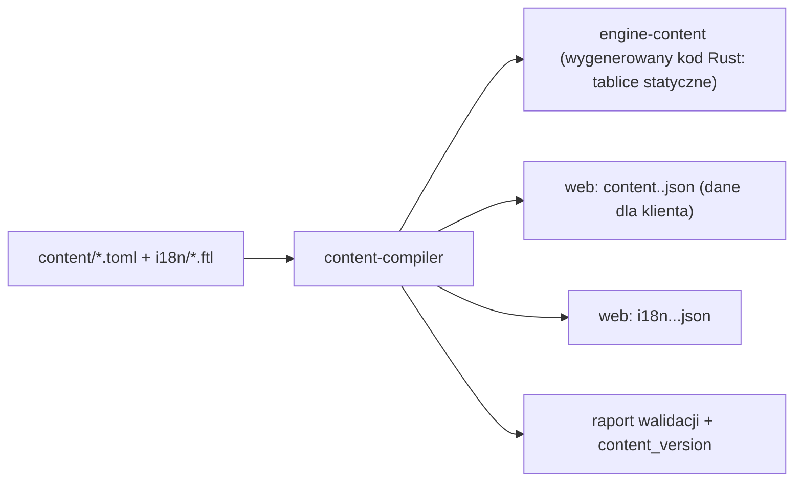

# 03. Treść gry i format danych

Dokument opisuje zawartość gry: szkoły, postacie, rozwój, karty, zestawy i wyprawy. Opisuje też, jak tę zawartość zapisujemy w danych i jak powstaje nowa treść. Zasady działania treści są w `02-zasady-gry.md`.

## 1. Zasada: mechanika z oryginału, treść własna

Decyzja ADR-012: **odtwarzamy mechanikę, ale nazwy, opisy, fabułę i grafiki tworzymy sami.**

| Element | Co robimy |
|---|---|
| Zasady i liczby (koszty, statystyki, progi) | punkt wyjścia z danych referencyjnych (`docs/dane/`), potem balans |
| Nazwy postaci, kart, dróg, darów, świata, tytułów | **nowe**, wymyślone przez nas |
| Teksty kart | **nowe** (oryginalne teksty i tak w większości się nie zachowały) |
| Grafiki, ikony, logo | **nowe** |
| Terminy ogólne (atak, obrona, szkoła walki, magia, nekromancja, combo, inicjatywa) | zostają, bo to słowa powszechne |

Każdy element treści ma **klucz** (stały identyfikator w kodzie, np. `card.ember_bolt`) i opcjonalne pole `ref` (identyfikator elementu referencyjnego, np. numer karty z `karty_klasyczne.csv`). Pole `ref` służy tylko projektantom: kompilator treści usuwa je z buildu produkcyjnego.

## 2. Szkoły

| Klucz | Robocza nazwa | Charakter mechaniczny (z analizy 338 kart) | Liczba kart ref. |
|---|---|---|---|
| `combat` | Walka | wzmocnienia AF/OF (broń, pancerze), uniki i pewne trafienia, odnowa W, ciosy specjalne, gra na koncentracji przeciwnika | 73 |
| `divine` | Kapłaństwo | leczenie i wskrzeszanie, ochrona, aury, obrażenia „święte”, efekty wyrównujące, odbieranie koncentracji | 45 |
| `element` | Elementalizm | bezpośrednie obrażenia (ogień, piorun, kamień), trucizny, natura (regeneracja, tarcze), chaos i losowość, wysysanie W obu stron | 58 |
| `arcane` | Magia | wzmocnienia AM/OM, przeciwzaklęcia, manipulacja czasem i ręką, obrażenia umysłowe, transformacje, obniżanie kosztów czarów | 62 |
| `necro` | Nekromancja | osłabienia i podatności, wysysanie Ż/W, klątwy (przeklęte przedmioty), odbieranie kart z ręki, wampiryzm, strach, umagicznienia długotrwałe | 59 |
| `tech` | Technologia | matryce ataku/obrony (I–III), optymalizacje statystyk, podnoszenie poziomów innych szkół, ładunki wybuchowe, rozpraszanie, „wszystkie ataki trafiają” | 58 |

Kapłaństwo i Nekromancja są w fabule przeciwstawne. Mechanicznie nie ma ogólnego zakazu łączenia ich: decydują o tym szablony postaci i drogi (np. cienie „Obłędu” łączą obie).

## 3. Postacie

### 3.1. Szablony referencyjne

Pełna tabela: `docs/dane/postacie.csv` (31 szablonów, nazwy oryginalne tylko jako referencja). Podsumowanie:

| Kategoria | Liczba | Jak zdobyć (R-PUL-05) | Uwagi |
|---|---|---|---|
| pospolita | 10 | start (6 z nich to postacie startowe szkół), arena, Spacer | statystyki bazowe zbalansowane |
| niepospolita | 7 | arena, Wyprawa | wyraźny profil (np. AF 6 / OF 0) |
| rzadka | 5 | arena (rzadko), Męka | dwie szkoły lub szkoła na poz. 2 |
| wysypisko | 3 | tylko wysypisko | 10 PR zamiast 6 |
| cień | 6 | tylko z poświęcenia Ascenta | 2/2/2/2, rozwój tylko przez PR |

**Postacie startowe szkół** (szablon referencyjny → szkoła): Nomad → Walka, Mnich → Kapłaństwo, Draco → Elementalizm, Czarodziej → Magia, Lady Kruk → Nekromancja, Doc → Technologia.

Rozrzut statystyk na poz. 1 (bez cieni): AF 2–6, OF 0–4, AM 2–4, OM 0–3, Ż 25–45, W 25–45. Suma czterech statystyk walki: 7–12.

### 3.2. Wzorzec krzywej rozwoju

Analiza 16 pełnych tabel rozwoju (`docs/dane/rozwoj_postaci.csv`):

| Wielkość | Przyrost poz. 1 → 20 | Uwagi |
|---|---|---|
| AF + OF + AM + OM | +14 … +20 (średnio ok. +17) | ok. 1 punkt co 1–1,5 poziomu, rozkład zgodny z profilem postaci |
| W | +55 … +90 | typowo +3 … +4 na poziom |
| Ż | +55 … +95 | typowo +3 … +6 na poziom |
| Szkoły | na poz. 1: 1–2 szkoły na poziomie 1; na poz. 20: dwie szkoły na poziomie 3 albo 3 + 2 | podwyżki najczęściej na poz. 5, 10 i 15, ale bywają na każdym poziomie |
| PR | 5: +1, 10: +2, 15: +1, 20: +2 (= 6) | wysypisko: +1 co 2 poziomy (= 10) |

**Generator brakujących tabel** (dla 15 szablonów bez danych) `[Z-GRW]`:
1. Profil postaci określa wagi rozkładu +17 punktów walki (np. „wojownik” 0,35/0,25/0,25/0,15).
2. Przyrosty rozkłada się deterministycznie, równomiernie co 1–2 poziomy.
3. W i Ż rosną po +3…+5 na poziom, tak żeby sumy mieściły się w zakresach z tabeli wyżej.
4. Szkoły rosną trzy razy, domyślnie na poz. 5, 10 i 15.
5. Wynik zapisuje się w danych jako zwykła tabela (generator to narzędzie projektanta, nie mechanizm runtime).

### 3.3. Drogi, specjalizacje, dary

Pełna tabela: `docs/dane/drogi_rozwoju.csv` (62 wiersze). Wzorce:
- Każda postać ma **2 drogi**. Każda droga ma **2 specjalizacje** i **2 dary** do wyboru.
- Specjalizacje to szkoła z profilu drogi (np. „Nekromancja lub Walka”) albo uniwersalne „Esencja” / „Koncentracja”. Postacie z wysypiska i cienie mają zawsze „Esencja lub Koncentracja”.
- Dary to w praktyce **efekty istniejących kart** (np. regeneracja, wampiryzm, „tancerz miecza”, laski szkół, aury), działające od początku pojedynku (R-REI-05, Z-GFT). Najczęstsze dary w danych: „Tancerz Miecza” (12 wystąpień), „Droga Miecza” (10), „Laska Arcymaga” (8), „Regeneracja” (7), „Laska Druida”, „Błogosławieństwo” i „Przekleństwo” (po 6), „Awatar”, „Wilkołactwo” i „Laboratorium” (po 5).
- Droga zmienia statystyki bazowe i szkoły. Przykład z danych 2010: postać „Gorylla” (Walka 1; AF 4, OF 1, AM 3, OM 1, Ż 40, W 25) na drodze nieumarłych dostaje Nekromancję 1, +1 AM, −5 Ż i +5 W.

### 3.4. Cienie

6 cieni, po jednym na szkołę. Drogi „Obłęd” (szkoła cienia na poz. 3 plus dwie szkoły przeciwne na poz. 1–2) i „Perfekcja” (szkoła cienia do poziomu 4, jedyna droga do Arcymistrza). Zasady: R-CIE-01…05.

## 4. Progi doświadczenia

`docs/dane/progi_doswiadczenia.csv`:

| Poz. | PD | Poz. | PD | Poz. | PD | Poz. | PD |
|---|---|---|---|---|---|---|---|
| 1 | 0 | 6 | 5 000 | 11 | 14 000 | 16 | 31 000 |
| 2 | 1 000 | 7 | 6 000 | 12 | 17 000 | 17 | 35 000 |
| 3 | 2 000 | 8 | 8 000 | 13 | 20 000 | 18 | 40 000 |
| 4 | 3 000 | 9 | 10 000 | 14 | 23 000 | 19 | 45 000 |
| 5 | 4 000 | 10 | 12 000 | 15 | 27 000 | 20 | 50 000 |

Reinkarnacja: 65 000 PD. Przy wzorze Z-XP (100 PD za wygraną z równym przeciwnikiem) to ok. 500 wygranych do poz. 20 i 650 do reinkarnacji. Tempo kalibrujemy w fazie F10 (`16-plan-wdrozenia.md`).

## 5. Karty

### 5.1. Zbiór referencyjny

`docs/dane/karty_klasyczne.csv`: 338 kart wersji klasycznej.

| Cecha | Rozkład |
|---|---|
| Rzadkość | złote 125, srebrne 110, brązowe 103 |
| Liczba szkół w wymaganiach | 1 szkoła: 306, 2 szkoły: 23, 3 szkoły: 1, brak: 8 |
| Najwyższy wymagany poziom | 1: 117, 2: 119, 3: 119 wystąpień. **Poziomu 4 nie wymaga żadna karta** |
| Rzadkość a poziom wymagań | brązowe głównie poz. 1 (73 ze 103), srebrne głównie poz. 2 (76 ze 110), złote głównie poz. 3 (97 ze 125) |
| Szkoły (wystąpienia w wymaganiach) | Walka 73, Magia 62, Nekromancja 59, Elementalizm 58, Technologia 58, Kapłaństwo 45 |

Koszty (186 kart ze znanymi kosztami z 2010):

| | K (min / mediana / max) | W (min / mediana / max) |
|---|---|---|
| brązowe | 1 / 2 / 4 | 1 / 6 / 24 |
| srebrne | 1 / 2 / 4 | 4 / 12 / 32 |
| złote | 1 / 3 / 6 | 1 / 16 / 36 |
| wymaganie poz. 1 | mediana 2 | mediana 6 |
| wymaganie poz. 2 | mediana 2 | mediana 12 |
| wymaganie poz. 3 | mediana 3 | mediana 18 |

Reguła kciuka do balansu: **koszt W ≈ 6 × najwyższy poziom wymagań**, a K 1–3 (silne efekty 4–6).

### 5.2. Znane teksty efektów (referencja)

Tylko ok. 20 kart ma zachowany opis (strony szczegółów 2010). Poniżej streszczenia mechaniki, które są wzorcami dla rodzin efektów:

| Ref. | Wymagania, rzadkość | Koszt K/W | Efekt (streszczenie) | Rodzina efektu |
|---|---|---|---|---|
| 1 | Walka 1, brązowa | 2 / 4 | +2 AF | `stat_mod` |
| 2 | Magia 1, brązowa | 1 / 4 | +2 AM | `stat_mod` |
| 3 | Walka 1, brązowa | 2 / 4 | +2 OF | `stat_mod` |
| 4 | Magia 1, brązowa | 1 / 4 | +2 OM | `stat_mod` |
| 5 | Walka 1, złota | 4 / 4 | +16 W, −1 AF i −1 OF | `stat_mod` + `stamina` |
| 6 | Walka 1, brązowa | 2 / 8 | leczy 6 Ż | `heal` |
| 7 | Walka 1, złota | 3 / 5 | zwiększa Ż i W (tekst w archiwum częściowo nieczytelny), ale postać otrzymuje podwójne obrażenia | `stat_mod` + `damage_taken_mult` |
| 8 | Walka 1, brązowa | 2 / 4 | pierwszy atak fizyczny przeciwnika nie trafia | `force_miss` |
| 9 | Walka 2 + Magia 1, srebrna | 2 / 8 | zamienia właściwości ataku i magii postaci | `swap_stats` |
| 10 | Walka 1 + Magia 2, srebrna | 1 / 10 | zamienia właściwości fizyczne i magiczne postaci | `swap_stats` |
| 33 | Elementalizm 2, srebrna | 2 / 12 | zamienia ataki z obronami przeciwnika | `swap_choices` |
| 48 | Kapłaństwo 1, brązowa | 1 / 6 | +2 Ż i W, +1 do obu obron | `stat_mod` |
| 208 | Kapłaństwo 1, brązowa | 2 / 8 | **umagicznienie**: co rundę dodaje Ż i W | `enchant(heal, stamina)` |
| 235 | Walka 3, złota | — | ataki fizyczne obu postaci trafiają | `force_hit(both, phys)` |
| 250 | Elementalizm 3, złota | 4 / 15 | ataki i obrony postaci = 0, +50 W | `stat_set` + `stamina` |
| 267 | Technologia 1, brązowa | — | +1 do obu obron | `stat_mod` |
| 268 | Technologia 2, srebrna | — | +2 do obu obron | `stat_mod` |
| 324 | Walka 1, złota | 1 / 8 | jeśli drugi atak trafił, trzeci trafia automatycznie | `force_hit(conditional)` |
| 353 (2010) | Kapłaństwo 1, brązowa | — | **umagicznienie**: każdy udany atak daje Ż i W | `enchant(on_hit)` |
| 383 (2010) | Kapłaństwo 1, brązowa | — | +1 do obu obron, +2 W | `stat_mod` |

Karty 353 i 383 są spoza listy klasycznej (dodane w 2010), a pozostałe mają te same numery w obu wersjach. Nazwy kart w obu wersjach czasem się różnią, dlatego tabela podaje tylko numery.

Z FAQ i poradników (S3, S9) znamy też działanie w zarysie: karta losowa (zastępowana losowym czarem), przeciwzaklęcie, „wszystkie ataki trafiają”, odbieranie kart z ręki przeciwnika, rozpraszanie umagicznień, odbieranie koncentracji, wysysanie W obu stron, podnoszenie poziomów szkół.

### 5.3. Biblioteka rodzin efektów

Efekty implementujemy jako **rodziny sparametryzowane** plus **efekty specjalne** w kodzie (ADR-006, `06-silnik-gry.md`, rozdz. 6). Minimalny zestaw rodzin pokrywający znane kategorie:

| Rodzina | Parametry | Przykład |
|---|---|---|
| `stat_mod` | cel (ja/przeciwnik/obaj), statystyka, wartość, czas (pojedynek/runda) | +2 AF do końca pojedynku |
| `stat_set` | cel, statystyki, wartość | ataki i obrony = 0 |
| `swap_stats` | cel, para statystyk (F↔M) | zamiana AF↔AM i OF↔OM |
| `heal` / `damage` | cel, wartość lub wyrażenie, typ obrażeń (czar) | leczy 6, zadaje 8 |
| `stamina` / `focus` | cel, wartość (+/−) | +16 W, −2 K przeciwnika |
| `drain` | z kogo, co (Ż/W/K), ile, komu | wysysa 6 Ż do siebie |
| `force_hit` / `force_miss` | cel, sloty lub typ, warunek | pierwszy atak F przeciwnika nie trafia |
| `unblockable` | cel, typ | ataki nie mogą być zablokowane |
| `swap_choices` | cel | zamiana ataków z obronami |
| `damage_taken_mult` | cel, mnożnik | podwójne obrażenia |
| `school_mod` | cel, szkoła, poziom | +1 do poziomu szkoły |
| `hand` | cel, akcja (odrzuć losową / dobierz / zablokuj) | przeciwnik odrzuca losową kartę |
| `dispel` | cel (moje/jego/wszystkie umagicznienia) | usuwa umagicznienia |
| `counter` | — | anuluje czar przeciwnika (R-CZA-05) |
| `random_spell` | pula | karta losowa (R-CZA-07) |
| `enchant` | wyzwalacz (co rundę, przy trafieniu, przy otrzymaniu obrażeń, koniec rundy) + efekt z listy wyżej | „co rundę +3 Ż” |
| `custom` | nazwa implementacji w kodzie | efekty unikalne |

### 5.4. Projektowanie nowych kart

Proces dla każdej karty (wymagany w fazach F2 i F10):
1. **Karta projektowa**: rola w talii (archetyp z S9: „zjadanie W”, „gra na koncentracji”, „umagicznienia”, „zmasowany atak”, „kumulacja obrażeń”, „odbieranie kart”, „jedna karta”), szkoła, rzadkość, poziom wymagań.
2. **Budżet**: koszt W i K zgodnie z regułą kciuka (5.1). Wartość efektu oceniona heurystyką mocy z symulatora (`11-ai-i-symulacje.md`, rozdz. 6).
3. **Implementacja**: dane (TOML) + rodzina efektu albo efekt `custom`.
4. **Test scenariuszowy** (`14-testy-i-jakosc.md`): co najmniej jeden na kartę.
5. **Symulacja**: karta w talii testowej nie może zmieniać współczynnika wygranych o więcej niż ustalony próg.
6. **Tekst** po polsku i angielsku. Tekst generuje się z parametrów, gdy to możliwe, żeby nie rozjeżdżał się z działaniem.
7. **Przegląd** przez drugą osobę (lub sesję AI z checklistą).

### 5.5. Zakres treści w kolejnych etapach

| Etap | Karty | Postacie | Uzasadnienie |
|---|---|---|---|
| MVP (M2–M3) | ok. 72 unikalne karty z 6 zestawów startowych | 6 postaci startowych | pełna rozgrywka każdą szkołą |
| Beta (M4) | +60 kart (do ok. 130), głównie srebrne | +10 postaci (pospolite i niepospolite) | sens kolekcjonowania i wymiany |
| Pełna wersja (M5) | ok. 330 kart w 5 dodatkach | 31 szablonów + drogi + cienie | odpowiednik oryginału |

Dodatki (edycje) w oryginale: „Core”, „Zemsta Technologa”, „Czas Oczekiwania”, „Trzeci Sztorm”, „Magia Utopców”. U nas edycje mają własne nazwy, a pole `set` w danych pozwala wydawać treść porcjami.

## 6. Zestawy startowe

`docs/dane/zestawy_startowe.csv`: każda szkoła daje 36–40 kart, z czego 10–14 różnych. Część kart wymaga poziomu 2 lub drugiej szkoły, więc nowicjusz nie zagra wszystkimi od razu (to zamierzone, `[Ź:S6]`). Nasze zestawy startowe budujemy według tej samej proporcji: około 2/3 kart grywalnych od poz. 1, 1/3 „na później”.

## 7. Zestawy kart, wysypisko, wyprawy

- **Zestawy kart:** R-SKL-01…04. Zawartość w `content/boosters.toml`.
- **Wysypisko:** R-WYS-01…03. Punkty za rzadkość w `content/rules.toml`.
- **Wyprawy:** R-WYP-01…06. Definicje trudności, pule przeciwników i bossów w `content/expeditions.toml`. Przeciwnicy to szablony postaci z poziomem względnym do gracza, talią archetypową i profilem AI (`11-ai-i-symulacje.md`, rozdz. 5).

## 8. Format danych

### 8.1. Układ katalogu `content/`

```
content/
  rules.toml            # parametry zasad (02-zasady-gry.md, rozdz. 13)
  schools.toml
  avatars/*.toml        # szablony postaci, drogi
  cards/<set>/*.toml    # karty, jeden plik na dodatek lub szkołę
  boosters.toml
  expeditions.toml
  bots.toml             # boty sali treningowej i profile AI
  economy.toml          # źródła i ujścia Dukatów
  i18n/pl.ftl, i18n/en.ftl   # teksty (Project Fluent: odmiana liczebników po polsku)
  _ref/mapping.csv      # klucz treści → id referencyjne (nie trafia do buildu)
```

**TOML** wybraliśmy, bo pozwala na komentarze, jest czytelny dla projektantów i ma natywne wsparcie w Rust (`serde`). **Fluent** wybraliśmy, bo obsługuje polskie formy liczby mnogiej (1 karta, 2 karty, 5 kart) i ma biblioteki dla Rust i TS.

### 8.2. Przykłady

Szablon postaci:

```toml
[[avatar]]
id = 101
key = "avatar.dune_runner"        # nasz klucz, nie nazwa z oryginału
ref = "Nomad"                     # tylko dla projektanta
rarity = "common"                 # common | uncommon | rare | junkyard | shade
starter_for = "combat"
base = { phys_atk = 4, phys_def = 3, mag_atk = 3, mag_def = 0, hp = 30, stamina = 30 }
schools = { combat = 1 }
dev_points = { 5 = 1, 10 = 2, 15 = 1, 20 = 2 }
growth = [
  # przyrosty: [AF, OF, AM, OM, W, Ż]
  { level = 2, d = [0, 0, 1, 0, 3, 6] },
  { level = 3, d = [1, 0, 0, 0, 3, 3] },
  { level = 5, d = [0, 0, 0, 0, 3, 4], schools = { combat = 2 } },
  # … do poziomu 20
]
paths = ["path.dune_runner.oasis", "path.dune_runner.sands"]
```

Karta (rodzina sparametryzowana):

```toml
[[card]]
id = 1
key = "card.bronze_edge"
ref = 1
set = "core"
rarity = "bronze"
requires = { combat = 1 }
cost = { focus = 2, stamina = 4 }
kind = "instant"                  # instant | enchantment
keywords = []                     # intervention | counter | coupling | random
effect = { family = "stat_mod", target = "self", stat = "phys_atk", amount = 2, duration = "duel" }
in_boosters = true
tags = ["buff", "physical"]
```

Karta z efektem w kodzie:

```toml
[[card]]
id = 233
key = "card.mirror_veil"
rarity = "gold"
requires = { arcane = 3 }
cost = { focus = 3, stamina = 18 }
kind = "enchantment"
effect = { family = "custom", impl = "mirror_veil", value = 50 }
```

Teksty (Fluent):

```ftl
card-bronze_edge-name = Brązowa Klinga
card-bronze_edge-text = Zwiększa atak fizyczny o { $amount }.
```

Zestaw kart:

```toml
[[booster]]
key = "basic"
price = 40
slots = [
  { rarity = "gold", count = 1 },
  { rarity = "silver", count = 3 },
  { rarity = "bronze", count = 8 },
]
```

### 8.3. Walidacja (kompilator treści)

Narzędzie `content-compiler` (Rust, część monorepo) odrzuca build, jeśli:
- identyfikatory lub klucze się powtarzają, albo odwołanie wskazuje na nieistniejący element;
- wymagania szkół są spoza zakresu 1–4, koszty są ujemne, a rodzina efektu ma niepoprawne parametry;
- tabela rozwoju nie obejmuje poziomów 2–20 albo suma PR nie zgadza się z harmonogramem;
- brakuje tekstu w `pl.ftl` lub `en.ftl`, albo tekst używa nieznanej zmiennej;
- efekt `custom` nie ma implementacji w rejestrze silnika (sprawdzane przez wygenerowany kod);
- karta nie ma ani jednego testu scenariuszowego (sprawdza osobny krok CI);
- zestaw kart losuje z rzadkości, która ma mniej niż 5 kart w sprzedaży.

### 8.4. Artefakty kompilacji i wersjonowanie



- `content_version` to skrót BLAKE3 znormalizowanej treści. Serwer podaje go w powitaniu protokołu (`07-protokol-sieciowy.md`), a klient pobiera plik `content.<hash>.json` cache'owany na stałe.
- Każdy zapis walki przechowuje `content_version` i `engine_version`, co umożliwia odtworzenie powtórek.
- Treść w produkcji zmienia się tylko przez wdrożenie (bez edycji „na żywo”). Upraszcza to determinizm i testy.

## 9. Grafika i dźwięk

Decyzja ADR-016: grafiki tworzy asystent AI (Claude) jako **grafikę wektorową SVG**, element po elemencie, a właściciel projektu wybiera warianty i zatwierdza wersje końcowe.

**Styl** (do ustalenia w przewodniku stylu, krok F3.6):
- emblematy i sygile szkół jako główny motyw wizualny;
- geometryczne, stylizowane portrety postaci (sylwetka, symbol, kolor szkoły), a nie realistyczne malarstwo;
- ramki kart według rzadkości (brązowa, srebrna, złota) i czytelny układ karty: nazwa, koszty K i W, wymagania, tekst, ilustracja;
- spójna paleta: jeden kolor przewodni na szkołę, wersje dla motywu jasnego i ciemnego.

**Kolejność prac:**

| Etap | Grafiki |
|---|---|
| F3.6 (przed MVP) | przewodnik stylu, ikony 6 szkół, ikony typów ataku i statystyk, ramki kart, 6 postaci startowych |
| F5 (klient) | elementy interfejsu: mapa z lokacjami, tła ekranów, ikona aplikacji PWA |
| F9 (beta) | ilustracje ok. 130 kart i 16 postaci |
| F10 (pełna treść) | pozostałe karty, drogi, dary, cienie |
| F12A (Android) | ikona aplikacji, ekran startowy, grafiki do Google Play (ikona 512 × 512, grafika 1024 × 500, zrzuty ekranu) |

**Proces dla każdego elementu:** opis → 2–3 warianty SVG → wybór i uwagi właściciela → poprawki → wersja końcowa w `art/` → optymalizacja SVGO → wpis w rejestrze pochodzenia (`12-bezpieczenstwo-i-prawo.md`, rozdz. 8). Do przeglądu służy prosta strona z galerią wariantów.

**Pliki:** źródła w `art/` (SVG i przewodnik stylu), wersje zoptymalizowane trafiają do pakietu klienta. Pliki PNG (Google Play, ikony PWA) są renderowane automatycznie z SVG w CI. Formaty i rozmiary: `10-klient-web.md`, rozdz. 9.

**Dźwięk:**
- Efekty dźwiękowe są generowane w przeglądarce przez Web Audio API (oscylatory, szum, obwiednie), więc nie wymagają plików i nie mają problemów licencyjnych.
- Muzyka jest opcjonalna i może pojawić się później, wyłącznie z udokumentowaną licencją.
