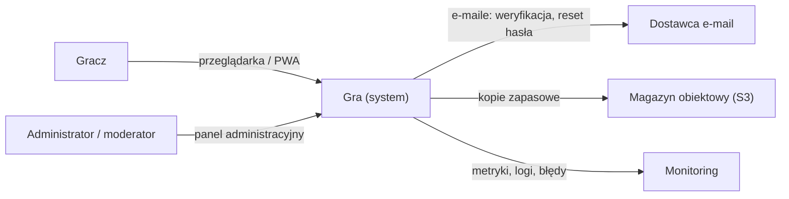
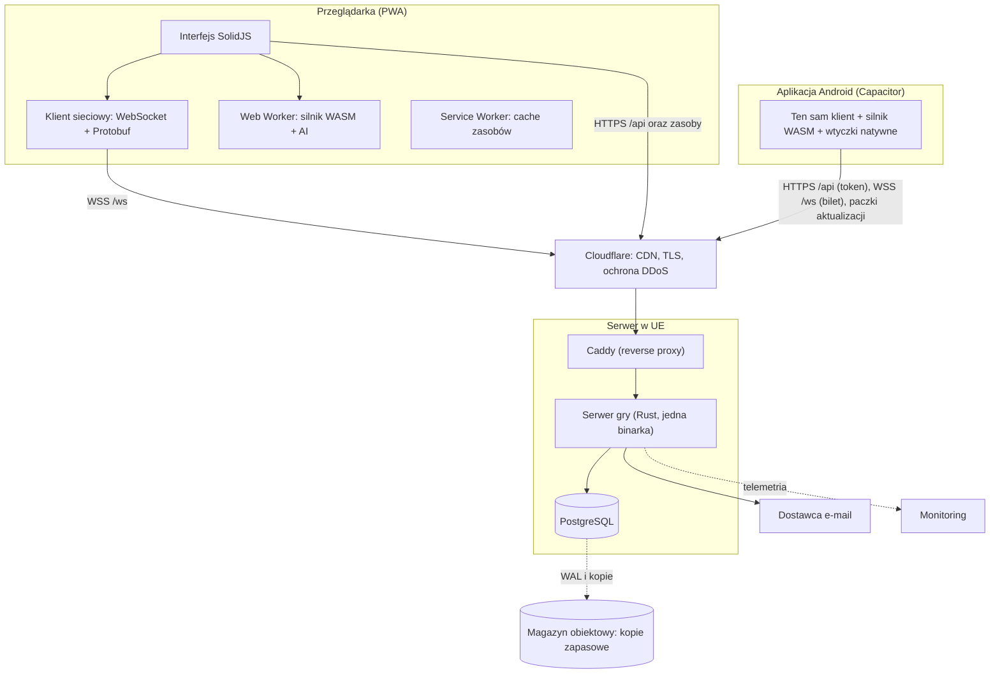
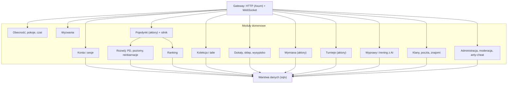
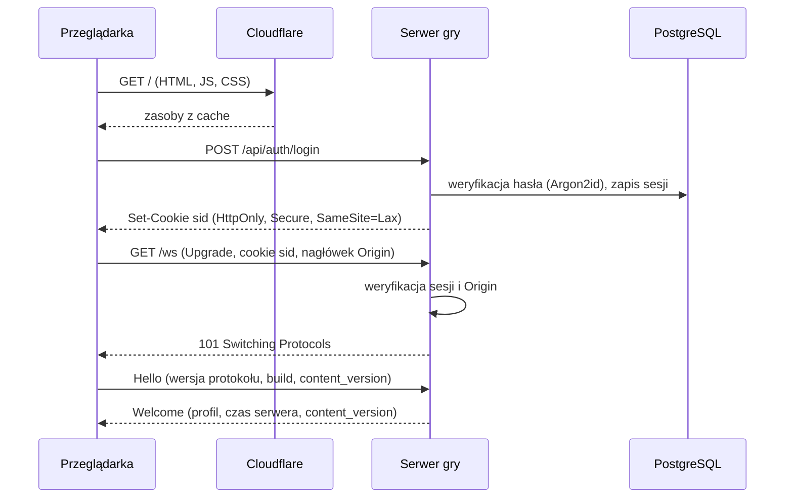
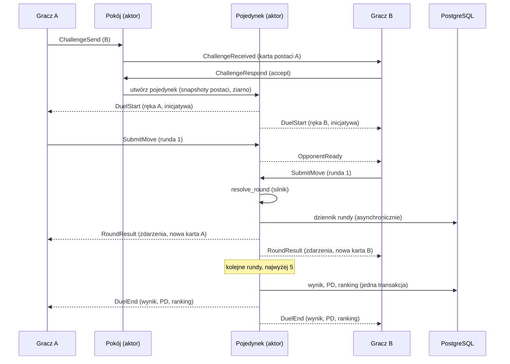
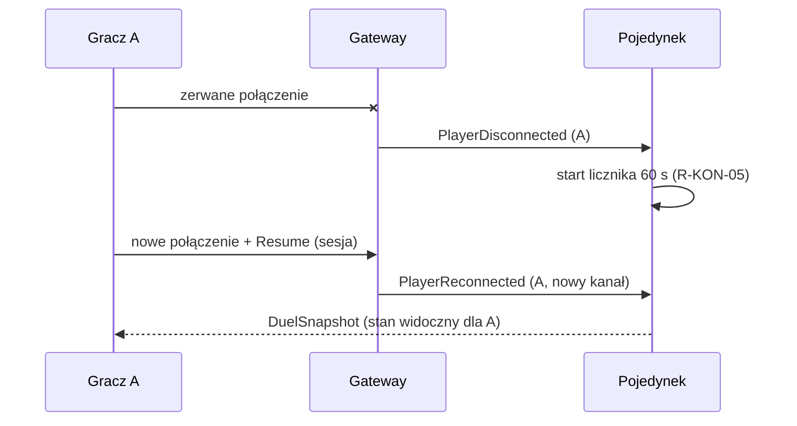
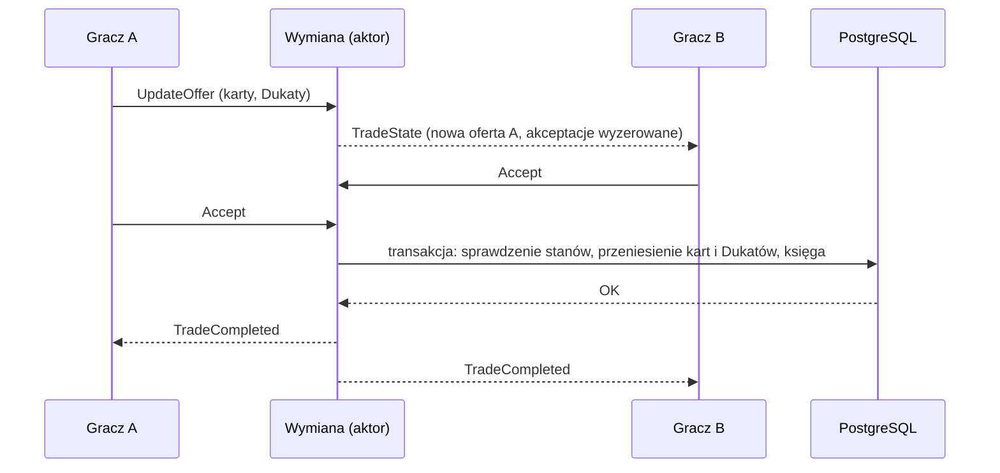
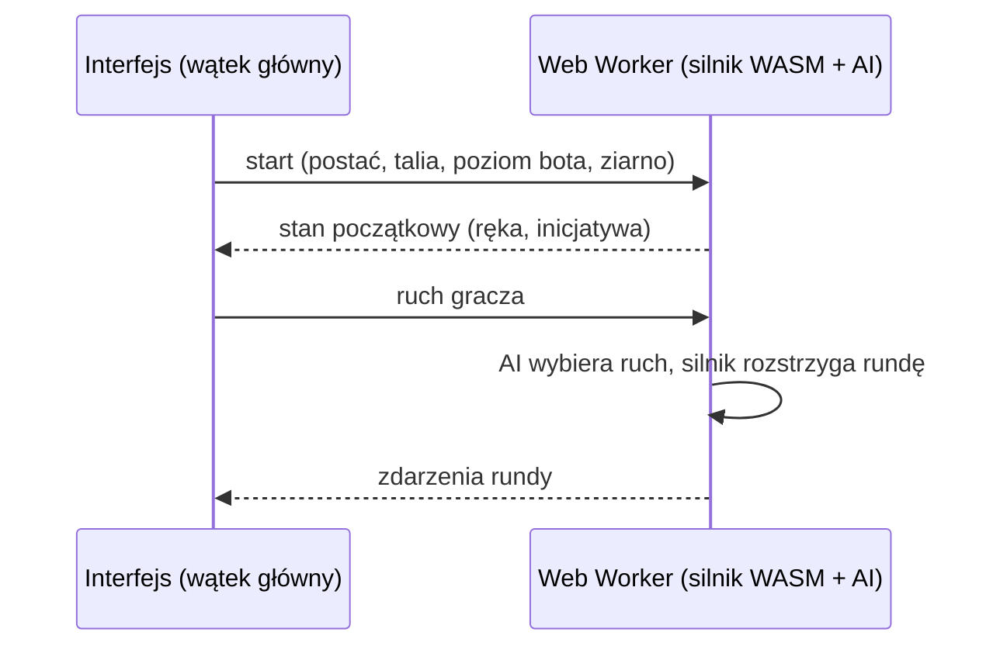

# 04. Architektura systemu

Dokument opisuje architekturę całego systemu: komponenty, przepływy, podział repozytorium i ścieżkę skalowania. Uzasadnienia wyborów technologicznych są w `05-decyzje-architektoniczne.md`, a szczegóły komponentów w dokumentach 06–11.

## 1. Cele i atrybuty jakości

Atrybuty w kolejności priorytetu. Przy konflikcie wygrywa wyższy.

| # | Atrybut | Co to znaczy w praktyce | Miara (szczegóły w `13-wydajnosc.md`) |
|---|---|---|---|
| Q1 | **Uczciwość** | serwer jest jedynym arbitrem; ukryte informacje (ręka, talia, ziarno losowania) nigdy nie trafiają do przeciwnika; zasady są deterministyczne | 0 rozbieżności w testach powtórek |
| Q2 | **Szybkość odczuwalna** | szybkie pierwsze ładowanie, natychmiastowa reakcja interfejsu, wynik rundy zaraz po drugim ruchu | LCP ≤ 1,5 s; wynik rundy p95 ≤ 100 ms (UE) |
| Q3 | **Efektywność zasobów** | jeden niedrogi serwer obsługuje tysiące jednoczesnych graczy | ≥ 5 000 połączeń na 4 vCPU (cel do potwierdzenia testem) |
| Q4 | **Prostota operacyjna** | jedna binarka serwera, jedna baza danych, mało ruchomych części | wdrożenie ≤ 10 min, bez przerywania walk |
| Q5 | **Testowalność** | czysty silnik bez wejścia/wyjścia, powtórki z ziarna i ruchów | pokrycie silnika ≥ 90%, każda reguła R-… ma test |
| Q6 | **Rozszerzalność treści** | nowe karty i postacie to głównie dane plus małe funkcje efektów | dodanie karty rodziny sparametryzowanej bez zmian w silniku |
| Q7 | **Bezpieczeństwo i prywatność** | ochrona kont, ekonomii i danych osobowych | `12-bezpieczenstwo-i-prawo.md` |

## 2. Kontekst systemu (C4, poziom 1)



## 3. Kontenery (C4, poziom 2)



| Kontener | Odpowiedzialność | Technologia |
|---|---|---|
| Interfejs | ekrany, animacje, obsługa wejścia | TypeScript, SolidJS, CSS |
| Klient sieciowy | jedno połączenie WebSocket, wiadomości Protobuf, ponowne łączenie, wznawianie sesji | TypeScript, `@bufbuild/protobuf` |
| Web Worker | silnik reguł (WASM): trening offline z AI, podgląd kosztów ruchu, walidacja talii, odtwarzanie powtórek | Rust → WebAssembly |
| Service Worker | cache zasobów statycznych, start offline w trybie treningu | Workbox lub własny SW |
| Aplikacja Android | ten sam klient w natywnej powłoce, gra wbudowana w APK, wtyczki natywne, podpisane aktualizacje paczek web (`19-aplikacja-android.md`) | Capacitor, Android System WebView |
| Cloudflare | TLS, CDN dla zasobów statycznych, ochrona przed DDoS, przekazywanie WebSocketów | usługa zewnętrzna |
| Caddy | reverse proxy, przełączanie wersji serwera przy wdrożeniu (blue/green) | Caddy |
| Serwer gry | API HTTP (logowanie, strony publiczne), WebSocket, cała logika domenowa | Rust, Tokio, Axum |
| PostgreSQL | konta, postacie, kolekcje, ekonomia, historia walk, klany, turnieje | PostgreSQL 17+ |

## 4. Wnętrze serwera gry



Zasady wewnętrzne (szczegóły w `08-serwer.md`):
- **Modularny monolit.** Moduły rozmawiają przez jawne interfejsy (funkcje usług i kanały aktorów), nie przez współdzielony stan.
- **Model aktorów.** Każdy pojedynek, pokój, sesja wymiany i turniej to osobne zadanie Tokio z własnym stanem i skrzynką wiadomości. Brak blokad w gorącej ścieżce.
- **Silnik jako biblioteka.** Aktor pojedynku woła czyste funkcje silnika (`resolve_round`); silnik nie wie nic o sieci ani bazie.
- **Baza tylko dla trwałego stanu.** Trwające pojedynki, pokoje i obecność są w pamięci, a każda runda trafia do dziennika w bazie (odtworzenie po restarcie).

## 5. Kluczowe przepływy

### 5.1. Logowanie i połączenie



### 5.2. Wyzwanie i pojedynek



### 5.3. Utrata i odzyskanie połączenia



### 5.4. Wymiana



### 5.5. Trening offline



Trening offline nie zmienia niczego na koncie (R-TRE-01), więc nie potrzebuje serwera. Gracz trenuje postaciami i taliami z ostatniej synchronizacji.

## 6. Gdzie są dane

| Dane | Miejsce | Trwałość | Uwagi |
|---|---|---|---|
| Treść gry (karty, postacie, zasady) | pliki w repo, wkompilowane w serwer i WASM; dla klienta JSON na CDN | wersjonowane (`content_version`) | zmiana tylko przez wdrożenie |
| Konta, postacie, kolekcje, talie, Dukaty | PostgreSQL | trwałe, kopie zapasowe, PITR | ekonomia przez księgę transakcji |
| Trwające pojedynki, pokoje, obecność, wymiany | pamięć serwera (aktory) | ulotne; pojedynki odtwarzalne z dziennika rund | `08-serwer.md`, rozdz. 5 |
| Historia walk (wynik + powtórka) | PostgreSQL (tabela partycjonowana po miesiącach) | trwałe; retencja do ustalenia | powtórka = ziarno + ruchy |
| Czat | pamięć, dziennik moderacji w PostgreSQL | retencja 30 dni | `12-bezpieczenstwo-i-prawo.md` |
| Zasoby statyczne (JS, CSS, WASM, grafiki) | CDN, nazwy z hashem | niezmienne | cache „immutable” |
| Telemetria | system monitoringu | 14–30 dni | — |

## 7. Struktura repozytorium (monorepo)

```
/
├─ Cargo.toml                  # workspace Rust
├─ package.json                # workspace pnpm (web, e2e)
├─ crates/
│  ├─ engine/                  # silnik reguł: czysty, deterministyczny, bez I/O
│  ├─ engine-cards/            # implementacje efektów (rodziny + custom)
│  ├─ engine-content/          # tablice treści wygenerowane przez content-compiler
│  ├─ engine-ai/               # boty (poziomy L0–L3)
│  ├─ engine-wasm/             # bindingi WebAssembly dla przeglądarki
│  ├─ protocol/                # typy z plików .proto (prost) i pomocnicze funkcje
│  ├─ server/                  # serwer gry (binarka)
│  ├─ content-compiler/        # walidacja i generowanie treści (binarka)
│  ├─ sim/                     # symulator balansu (binarka)
│  └─ loadtest/                # boty do testów obciążeniowych (binarka)
├─ proto/                      # schematy Protobuf: źródło prawdy protokołu
├─ content/                    # dane gry (TOML, Fluent)
├─ web/                        # klient (SolidJS, TypeScript, Vite)
├─ mobile/                     # powłoka Android (Capacitor): konfiguracja, projekt Gradle, ikony
├─ art/                        # źródła grafik SVG i przewodnik stylu (ADR-016)
├─ e2e/                        # testy end-to-end (Playwright)
├─ deploy/                     # Dockerfile, docker-compose, Caddy, skrypty
├─ docs/                       # dokumentacja
└─ .github/workflows/          # CI/CD
```

Nazwy pakietów i crate'ów są neutralne (bez marki), więc zmiana nazwy produktu nie wymaga zmian w kodzie (ADR-012). Nazwa „Spellgambit: Arcane Class” występuje tylko w tekstach i konfiguracji widocznej dla gracza (`20-nazwa-i-znak-towarowy.md`, rozdz. 1).

## 8. Stos technologiczny

| Warstwa | Wybór | Najważniejszy powód | ADR |
|---|---|---|---|
| Silnik reguł | Rust (stabilny), bez alokacji w gorącej ścieżce | determinizm, szybkość, jeden kod dla serwera i przeglądarki | 001 |
| Silnik w przeglądarce | WebAssembly (`wasm-bindgen`, `wasm-opt`) w Web Workerze | trening offline, podgląd ruchów bez serwera | 001 |
| Serwer | Rust, Tokio, Axum, tower | wydajność bez przerw na GC, bezpieczeństwo pamięci | 002 |
| Protokół | WebSocket + Protobuf (`prost`, `@bufbuild/protobuf`); HTTP/JSON dla logowania i stron publicznych | małe wiadomości, schemat niezależny od języka | 003 |
| Klient | TypeScript (strict), SolidJS, Vite, CSS Modules | bardzo mały narzut biblioteki, szybki DOM | 004 |
| Aplikacja mobilna | Capacitor (Android); Google Play (AAB) + APK ze strony | jeden kod klienta, gra offline w pakiecie | 014, 015 |
| Grafika | SVG tworzone przez asystenta AI, optymalizacja SVGO | małe pliki, ostre na każdym ekranie | 016 |
| Baza | PostgreSQL + `sqlx` (zapytania sprawdzane przy kompilacji) | transakcje, niezawodność, jedna baza na wszystko | 005 |
| Treść | TOML + Project Fluent, kompilowane do Rust i JSON | czytelność dla projektantów, walidacja przy budowaniu | 006 |
| Losowość | ChaCha8 z ziarnem na pojedynek | determinizm i powtórki | 007 |
| Hosting | Docker, Caddy, Cloudflare, VPS w UE (np. Hetzner) | niski koszt, mała złożoność | 008 |
| CI/CD | GitHub Actions, rejestr obrazów GHCR | repo jest na GitHubie | 008 |
| Obserwowalność | `tracing` + OpenTelemetry, Prometheus, Grafana, Loki; Sentry lub GlitchTip | standardowe, tanie narzędzia | 008 |

**Polityka wersji:** dokładne wersje zależności ustala się w kroku F0.2 (`16-plan-wdrozenia.md`) i blokuje plikami `Cargo.lock` i `pnpm-lock.yaml`. Aktualizacje przez Renovate, w małych PR-ach z pełnym CI.

## 9. Zagadnienia przekrojowe

| Temat | Rozwiązanie |
|---|---|
| Konfiguracja | zmienne środowiskowe (sekrety, adresy) + plik TOML (parametry). Parametry zasad są w treści gry, nie w konfiguracji serwera |
| Identyfikatory | UUIDv7 dla encji w bazie (sortowalne w czasie); liczby całkowite dla treści |
| Czas | jedynym źródłem czasu jest zegar serwera (UTC). Klient dostaje `server_time` i liczy przesunięcie tylko do wyświetlania liczników |
| Błędy | kody błędów w protokole (enum), komunikaty dla gracza po stronie klienta (i18n); szczegóły tylko w logach |
| Logi | ustrukturyzowane (JSON), korelacja przez `trace_id`, bez danych osobowych w treści logów |
| i18n | PL i EN od początku; teksty treści w Fluent, interfejs w Fluent; serwer wysyła kody, nie teksty |
| Flagi funkcji | proste flagi w konfiguracji serwera (np. `features.trading`), przekazywane klientowi w `Welcome` |
| Wersjonowanie | protokół: `major.minor`; silnik: semver; treść: `content_version` (hash). Niezgodny klient dostaje komunikat o aktualizacji |

## 10. Granice zaufania

- **Klient nigdy nie decyduje o wyniku.** Podgląd kosztów i walidacja w WASM służą tylko wygodzie; serwer zawsze sprawdza ruch ponownie.
- **Ukryte informacje** (ręka przeciwnika, kolejność talii, ziarno losowania trwającego pojedynku) nie opuszczają serwera. Ziarno trafia do powtórki dopiero po zakończeniu walki.
- **Czas klienta** nie ma znaczenia dla logiki. Limity czasu liczy serwer.
- **Treść** po stronie klienta jest jawna (to dane gry), ale klient nie może jej zmienić w sposób wpływający na serwer.
- **Aplikacja Android** jest takim samym niezaufanym klientem jak przeglądarka. Różni się tylko sposobem logowania (token i bilet WebSocket, ADR-015) oraz tym, że paczki aktualizacji przyjmuje wyłącznie z ważnym podpisem.

## 11. Skalowanie

| Etap | Kiedy | Topologia | Co się zmienia |
|---|---|---|---|
| 1 (start) | do kilku tysięcy jednoczesnych graczy | jeden VPS (np. 4 vCPU, 8–16 GB): Caddy + serwer gry + PostgreSQL; Cloudflare przed nim | nic: wszystko w jednym procesie |
| 2 | CPU > 60% przez dłuższy czas albo > 70% przetestowanej liczby połączeń | PostgreSQL na osobnej maszynie; 2+ instancje serwera gry; NATS (lub Redis) do zdarzeń między instancjami (obecność, czat globalny, wyzwania między instancjami) | gracz przypisany do instancji (sticky routing według `user_id`); pojedynek żyje na instancji wyzywającego |
| 3 | dziesiątki tysięcy graczy lub gracze spoza Europy | repliki odczytu bazy, partycjonowanie historii walk, instancje regionalne | rankingi i profile czytane z replik |

Projekt etapu 1 nie blokuje etapu 2: obecność i czat przechodzą przez interfejs „magistrali zdarzeń”. Na etapie 1 to implementacja w pamięci procesu, na etapie 2 NATS.
