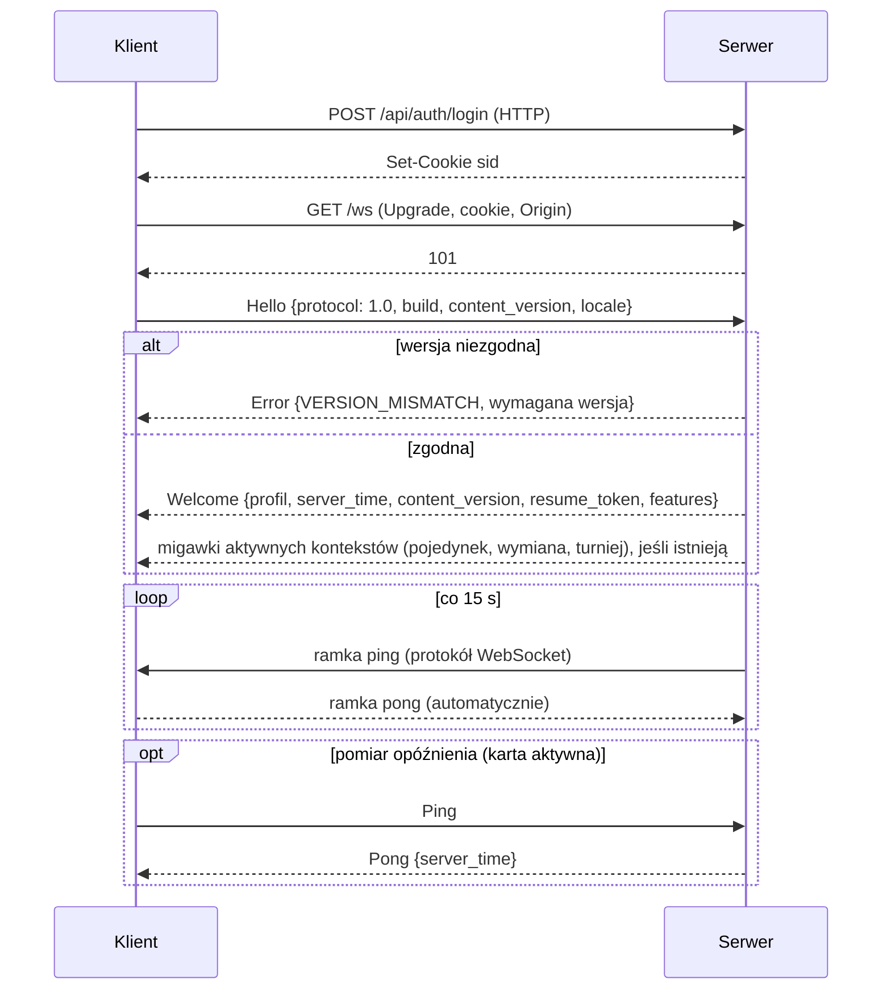
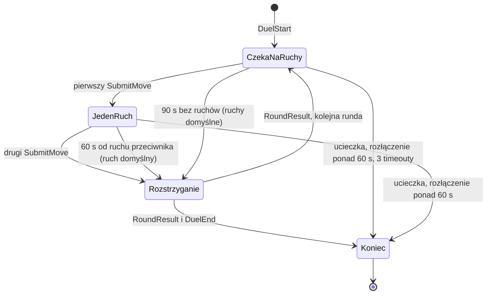

# 07. Protokół sieciowy

Komunikacja klient–serwer: WebSocket z wiadomościami Protobuf dla gry w czasie rzeczywistym i HTTP/JSON dla logowania i stron publicznych (ADR-003). Źródłem prawdy są pliki `proto/game/v1/*.proto`; ten dokument opisuje ich znaczenie i zasady użycia.

## 1. Transport

| Element | Ustalenie |
|---|---|
| Adres | `wss://<domena>/ws` (ta sama domena co aplikacja, ADR-010). Aplikacja Android łączy się z `wss://<domena>/ws?ticket=<bilet>` (ADR-015) |
| Ramki | binarne; jedna ramka = jedna wiadomość Protobuf (`ClientMessage` albo `ServerMessage`) |
| Kompresja | wyłączona (`permessage-deflate` nie opłaca się przy wiadomościach < 1 KB) |
| Rozmiar | klient → serwer ≤ 16 KB; serwer → klient ≤ 256 KB (migawki stanu) |
| Puls | serwer wysyła ramki ping protokołu WebSocket co 15 s, a przeglądarka odpowiada na nie automatycznie, także w karcie działającej w tle. Serwer zamyka połączenie po 30 s bez żadnej ramki od klienta `[Ź:S2: 30 s]`. Wiadomość `Ping` aplikacji służy tylko do pomiaru opóźnienia i synchronizacji zegara, bo przeglądarki spowalniają timery w kartach w tle |
| Połączenia | jedno aktywne połączenie na konto. Nowe połączenie przejmuje sesję, a stare dostaje `SessionReplaced` i jest zamykane |

## 2. Cykl życia połączenia



**Wznawianie** po utracie połączenia:
1. Klient łączy się ponownie z wykładniczym opóźnieniem: 0,5 s, 1 s, 2 s, 4 s, maks. 8 s, z losowym rozrzutem.
2. Wysyła `Resume {resume_token}` zamiast `Hello`.
3. Serwer odtwarza sesję i wysyła **aktualne migawki** (`RoomSnapshot`, `DuelSnapshot`, `TradeState`, `TournamentState`). Nie odtwarza utraconych wiadomości, więc stan zawsze jest spójny.
4. Pojedynek czeka na gracza najwyżej 60 s (R-KON-05).

## 3. Koperta wiadomości

```proto
message ClientMessage {
  uint32 seq = 1;                 // numer żądania klienta (korelacja odpowiedzi)
  oneof body { /* wiadomości z rozdz. 4 */ }
}

message ServerMessage {
  uint32 seq = 1;                 // rosnący numer wiadomości serwera w sesji
  uint32 reply_to = 2;            // seq żądania, jeśli to odpowiedź; 0 dla powiadomień
  oneof body { /* wiadomości z rozdz. 4 */ }
}

message Error {
  ErrorCode code = 1;
  uint32 detail = 2;              // np. MoveError, gdy code = INVALID_MOVE
  string debug = 3;               // tylko w buildach deweloperskich
}
```

Każde żądanie dostaje **dokładnie jedną** odpowiedź: `Ok` (z danymi) albo `Error`. Powiadomienia serwera (`reply_to = 0`) nie wymagają potwierdzenia.

## 4. Katalog wiadomości

Wiadomości są pogrupowane według domen. „K→S” oznacza klient → serwer, „S→K” serwer → klient.

### 4.1. Sesja

| Wiadomość | Kierunek | Najważniejsze pola |
|---|---|---|
| `Hello` | K→S | `protocol_major`, `protocol_minor`, `build`, `content_version`, `locale`, `client_kind` (`web`, `android`), `native_version` (wersja powłoki aplikacji; puste w przeglądarce) |
| `Welcome` | S→K | `profile`, `server_time_ms`, `content_version`, `resume_token`, `features[]` |
| `Resume` | K→S | `resume_token` |
| `Ping` / `Pong` | K→S / S→K | `server_time_ms` w `Pong` |
| `SessionReplaced` | S→K | — (zaraz potem zamknięcie połączenia) |
| `ServerNotice` | S→K | `kind` (konserwacja, ogłoszenie), `text_key`, `params`, `at` |

### 4.2. Pokoje, obecność, czat

| Wiadomość | Kierunek | Pola |
|---|---|---|
| `RoomJoin` / `RoomLeave` | K→S | `room` (arena, trening, zamek, portal, bazar, klan) |
| `RoomSnapshot` | S→K | lista graczy (nazwa, tytuł, aktywna postać, poziom, filtr wyzwań, AFK, klan), ostatnie pojedynki |
| `RoomDelta` | S→K | `joined[]`, `left[]`, `updated[]` |
| `ChatSend` | K→S | `channel` (pokój, prywatny, klan), `to` (dla prywatnego), `text` (≤ 300 znaków) |
| `ChatMessage` | S→K | `channel`, `from`, `text`, `at` |
| `SetChallengeFilter` | K→S | `ALL`, `LEVEL_PM2`, `NONE` (R-LOB-03) |
| `SetAfk` | K→S | `afk` |
| `WhoIs` / `PlayerInfo` | K→S / S→K | nazwa → profil publiczny |

Komendy czatu (`/t`, `/r`, `/c`, `/f`, `/i`, `/afk`, `/w`, R-KOM-02) przetwarza **klient** i zamienia je na odpowiednie wiadomości. Serwer nie parsuje tekstu komend.

### 4.3. Wyzwania

| Wiadomość | Kierunek | Pola |
|---|---|---|
| `ChallengeSend` | K→S | `target` |
| `ChallengeReceived` | S→K | `challenge_id`, `from` (karta postaci, ranking, pozycja, tytuł, klan, statystyki, opis), `expires_at` |
| `ChallengeRespond` | K→S | `challenge_id`, `accept` |
| `ChallengeCancel` | K→S | `challenge_id` |
| `ChallengeUpdate` | S→K | `challenge_id`, `status` (zaakceptowane, odrzucone, wygasłe, anulowane) |

### 4.4. Pojedynek

| Wiadomość | Kierunek | Pola |
|---|---|---|
| `DuelStart` | S→K | `duel_id`, `kind` (arena, trening, turniej, wyprawa), `you`, `opponent` (snapshoty publiczne), `initiative`, `hand[]`, `deck_count`, `default_settings`, `seed_commitment`, `round_deadline` |
| `DuelSubmitMove` | K→S | `duel_id`, `round`, `attacks[3]`, `defenses[3]`, `card_action` (none / cast idx / discard idx) |
| `DuelMoveAccepted` | S→K | odpowiedź na ruch; ruch jest ostateczny (R-RUN-07) |
| `DuelOpponentReady` | S→K | `deadline` (60 s od teraz, R-RUN-08) |
| `DuelRoundResult` | S→K | `round`, `events[]` (przefiltrowane dla odbiorcy), `drawn_cards[]` (tylko własne), `next_deadline`, `state_hash` |
| `DuelEnd` | S→K | `outcome`, `reason`, `xp_gained`, `rating_delta`, `rating_new`, `rewards[]`, `seed`, `match_id` |
| `DuelForfeit` | K→S | `duel_id` |
| `DuelSnapshot` | S→K | pełny `PlayerView` (po wznowieniu) |
| `DuelOpponentConnection` | S→K | `connected`, `grace_until` |

`state_hash` pozwala klientowi wykryć rozjazd stanu (np. błąd w odtwarzaniu zdarzeń). Przy niezgodności klient prosi o `DuelSnapshot`.

**Automat stanów pojedynku (po stronie serwera):**



### 4.5. Trening, wyprawy, turnieje

| Wiadomość | Kierunek | Pola |
|---|---|---|
| `TrainingChallengeBot` | K→S | `bot_id` (bot z sali treningowej; walka online, R-TRE-01) |
| `ExpeditionStart` | K→S | `difficulty` |
| `ExpeditionState` | S→K | etap, grupa 3 przeciwników (nazwa, poziom, kolor trudności), zebrane PD, czy boss |
| `ExpeditionChooseEnemy` | K→S | indeks przeciwnika (potem zwykły `DuelStart`) |
| `ExpeditionRetreat` | K→S | — (R-WYP-04) |
| `ExpeditionResult` | S→K | PD, nagroda (postać / karta / Dukaty / brak) |
| `TournamentCreate` | K→S | parametry z R-TUR-01 |
| `TournamentList` / `TournamentState` | S→K | lista turniejów / drabinka, punkty, stany graczy (kolory z S2), zegary |
| `TournamentJoin` / `TournamentLeave` | K→S | `tournament_id`, `avatar_id` |
| `TournamentReady` | K→S | gotowość do walki (R-TUR-06) |

### 4.6. Postacie, talie, kolekcja

| Wiadomość | Kierunek | Pola |
|---|---|---|
| `AvatarCreate` | K→S | `template_id`, `slot` |
| `AvatarDelete` | K→S | `avatar_id` (R-PUL-03) |
| `AvatarActivate` | K→S | `avatar_id` |
| `AvatarSpendDevPoint` | K→S | `avatar_id`, `stat` (R-ROZ-04) |
| `AvatarReincarnate` | K→S | `avatar_id`, `choice` (droga / specjalizacja / dar) |
| `AvatarCreateShade` | K→S | `sacrifice_avatar_id`, `school` (R-CIE-01) |
| `DeckSave` | K→S | `avatar_id`, `cards[]` (R-TAL-01…04) |
| `DeckPresetSave` / `DeckPresetDelete` | K→S | `name`, `cards[]` |
| `ProfileUpdate`, `CollectionDelta`, `AvatarUpdate` | S→K | zmiany stanu konta, wysyłane po każdej operacji |

### 4.7. Ekonomia i wymiana

| Wiadomość | Kierunek | Pola |
|---|---|---|
| `ShopBuy` | K→S | `booster_key`, `idempotency_key` (UUID) |
| `BoosterOpen` | K→S | `booster_id` |
| `BoosterOpened` | S→K | `cards[]` |
| `JunkyardDiscard` | K→S | `cards[] {card_id, count}`, `idempotency_key` |
| `JunkyardResult` | S→K | punkty, nagroda |
| `TradeInvite` / `TradeRespond` / `TradeCancel` | K→S | `target` / `trade_id`, `accept` |
| `TradeUpdateOffer` | K→S | `trade_id`, `cards[]`, `ducats` |
| `TradeAccept` | K→S | `trade_id`, `offer_version` (akceptacja dotyczy konkretnej wersji ofert, R-WYM-03) |
| `TradeState` | S→K | obie oferty, `offer_version`, flagi akceptacji |
| `TradeCompleted` | S→K | `trade_id` |

`idempotency_key` sprawia, że powtórzenie żądania po zerwanym połączeniu nie kupi zestawu dwa razy.

### 4.8. Klany i społeczność

| Wiadomość | Kierunek | Pola |
|---|---|---|
| `ClanCreate`, `ClanApply`, `ClanDecide`, `ClanSetRole`, `ClanKick`, `ClanLeave`, `ClanUpdateInfo` | K→S | zgodnie z R-KLA-01…05 |
| `ClanState` | S→K | profil klanu, członkowie, wnioski (dla uprawnionych) |
| `FriendAdd`, `FriendRemove`, `IgnoreAdd`, `IgnoreRemove` | K→S | `player` |
| `MailSend`, `MailList`, `MailRead`, `MailDelete` | K→S | poczta offline (R-KOM-04) |
| `RankingGet`, `MatchHistoryGet`, `ProfileGet` | K→S | stronicowanie: `cursor`, `limit` |

## 5. Kody błędów

| Kod | Kiedy |
|---|---|
| `UNAUTHENTICATED` | brak lub wygasła sesja |
| `VERSION_MISMATCH` | niezgodna główna wersja protokołu |
| `INVALID_MESSAGE` | nie da się zdekodować wiadomości albo pola są poza zakresem |
| `RATE_LIMITED` | przekroczony limit (rozdz. 6) |
| `FORBIDDEN` | brak uprawnień (np. operacja klanowa bez roli) |
| `GUEST_RESTRICTED` | funkcja niedostępna dla konta z niepotwierdzonym e-mailem (R-KNT-02, historyczna nazwa kodu); lokalny gość nie używa API |
| `NOT_FOUND` | nieistniejący obiekt |
| `CONFLICT` | stan się zmienił (np. ruch już wysłany, nieaktualna wersja oferty) |
| `BUSY` | gracz jest już w pojedynku albo ma aktywne wyzwanie (R-LOB-06) |
| `INSUFFICIENT_FUNDS` / `INSUFFICIENT_CARDS` | za mało Dukatów lub kart |
| `INVALID_MOVE` | ruch niezgodny z zasadami; `detail` = `MoveError` z silnika |
| `TIMEOUT` | upłynął czas operacji |
| `MAINTENANCE` | tryb konserwacji: nowe pojedynki są blokowane |
| `INTERNAL` | nieoczekiwany błąd (szczegóły tylko w logach serwera) |

## 6. Limity i ochrona

| Limit | Wartość domyślna |
|---|---|
| wiadomości ogółem | 30/s, chwilowo do 60 (token bucket na połączenie) |
| czat | 5 wiadomości / 10 s (gość: 2 / 10 s); powtórzenie tej samej treści blokowane |
| wyzwania | 10 / min |
| zmiany oferty w wymianie | 5 / s |
| `DuelSubmitMove` | jeden zaakceptowany na rundę |
| połączenia z jednego IP | 20 jednoczesnych (konfigurowalne; NAT w szkołach i akademikach) |
| nieudane logowania | 5 na 15 min na konto i 20 na 15 min na IP, potem opóźnienia |

Wszystkie pola tekstowe mają limity długości i są sprawdzane po stronie serwera. Wiadomości o nieznanym typie są ignorowane (zgodność w przód), a nieparsowalne kończą połączenie po 3 wystąpieniach.

## 7. Wersjonowanie protokołu

- `protocol_major.protocol_minor` w `Hello`. Serwer obsługuje bieżący `major` i każdy `minor` ≤ swojego.
- **Zmiana zgodna** (minor): nowe pola i nowe wiadomości. Nigdy zmiana numeru ani typu istniejącego pola.
- **Zmiana niezgodna** (major): nowy pakiet `game.v2`. Stary klient dostaje `VERSION_MISMATCH` i przeładowuje aplikację (Service Worker pobiera nową wersję).
- Usunięte pola oznacza się `reserved` (numer i nazwa).
- `buf lint` i `buf breaking` w CI pilnują zasad ewolucji schematu.

## 8. HTTP API

| Metoda i ścieżka | Opis | Uwierzytelnienie |
|---|---|---|
| `POST /api/auth/register` | login, e-mail, hasło, szkoła startowa | — |
| `POST /api/auth/login` | login lub e-mail, hasło. Z `client = android` zwraca token sesji aplikacji w treści odpowiedzi zamiast ciasteczka (ADR-015) | — |
| `POST /api/auth/ws-ticket` | jednorazowy bilet do WebSocket, ważny 30 s (aplikacja Android) | `Authorization: Bearer` |
| `POST /api/auth/rotate` | wymiana tokenu aplikacji na nowy (co 7 dni) | `Authorization: Bearer` |
| `POST /api/auth/logout` | — | sesja |
| `POST /api/auth/verify-email` | token z e-maila | — |
| `POST /api/auth/verify-email/request` | ponowne wysłanie linku; odpowiedź nie ujawnia istnienia konta | — |
| `GET /api/auth/options` | publiczny klucz CAPTCHA lub `null` w środowisku lokalnym | — |
| `GET /api/auth/sessions` / `DELETE /api/auth/sessions/{id}` | lista aktywnych sesji / zakończenie własnej sesji | sesja |
| `POST /api/auth/password-reset/request` / `confirm` | reset hasła | — |
| `GET /api/me` | stan sesji i profilu (start aplikacji) | sesja |
| `GET /api/me/export` | eksport danych osobowych (RODO) | sesja + ponowne podanie hasła |
| `DELETE /api/me` | usunięcie konta (RODO), z okresem karencji | sesja + ponowne podanie hasła |
| `GET /api/public/ranking` | ranking graczy i klanów (stronicowany) | — (cache CDN 60 s) |
| `GET /api/public/players/{nazwa}` | profil publiczny | — (cache 60 s) |
| `GET /api/public/matches/{id}` | wynik i powtórka walki | — (cache długi) |
| `GET /healthz`, `GET /readyz` | stan procesu (dla Caddy i monitoringu) | sieć wewnętrzna |
| `GET /metrics` | metryki Prometheus | sieć wewnętrzna |
| `/api/admin/*` | panel administracyjny (`08-serwer.md`, rozdz. 12) | rola admin + 2FA + lista IP |

Żądania zmieniające stan wymagają nagłówka `X-Requested-With: app` (ADR-010). Odpowiedzi błędów mają postać `{ "error": "<KOD>" }` z kodami jak w rozdz. 5.

W F6.2 logowanie przyjmuje JSON `{identity,password,client?:"web"|"android"}`, rejestracja `{login,email,password,school,client?,captcha_token?}`. Logowanie web zwraca `{profile}` i ciasteczko, aplikacja `{profile,token,expires_in}` bez ciasteczka. Rejestracja zwraca 201 `{registered:true}`; nie tworzy automatycznie sesji. Szczegóły wdrożonego kontraktu: [raport F6.2](23-konta-i-gosc-testy.md). Gość lokalny nie ma endpointu i nie wysyła żądań (ADR-018).

Endpointy wymagające sesji przyjmują ciasteczko (przeglądarka) albo nagłówek `Authorization: Bearer` (aplikacja Android). CORS jest włączony tylko dla pochodzenia aplikacji `https://localhost`, bez ciasteczek. Manifest i paczki aktualizacji aplikacji (`/app-bundles/manifest.json`, `/app-bundles/<wersja>.zip`) to pliki statyczne na CDN (`19-aplikacja-android.md`, rozdz. 5). Serwer odrzuca powłokę starszą niż `APP_MIN_NATIVE_VERSION` błędem `VERSION_MISMATCH`.

## 9. Narzędzia deweloperskie

- **Inspektor protokołu** (tylko build deweloperski): panel w kliencie z listą wiadomości przychodzących i wychodzących, zdekodowanych do JSON, z filtrem i eksportem.
- **Klient konsolowy** (`crates/loadtest`, tryb interaktywny): łączy się z serwerem i pozwala wysyłać wiadomości ręcznie. Przydaje się w testach i przy diagnozie.
- **Nagrywanie sesji:** w środowisku testowym serwer może zapisać wszystkie wiadomości sesji do pliku, co pozwala odtworzyć zgłoszony błąd.
