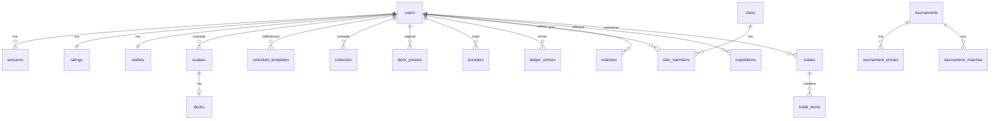

# 09. Baza danych

PostgreSQL (wersja 17 lub nowsza) przechowuje wszystkie dane trwałe (ADR-005). Treść gry (karty, postacie, zasady) **nie** jest w bazie, bo jest wkompilowana w serwer (`03-tresc-gry.md`, rozdz. 8). Baza przechowuje tylko identyfikatory treści.

**Stan F6.2 (2026-10-15).** Zaimplementowane tabele: `users`, `sessions`, `email_tokens`, `unlocked_templates`, `avatars`, `collection`, `decks`, `deck_presets`, `ratings`. Pozostałe tabele i operacje w tym dokumencie są planem dalszych faz. Cztery migracje F6.1 w `migrations/` przechodzą testy na PostgreSQL 18.6; procedurę opisuje [raport F6.1](22-baza-migracje-testy.md). Rejestrację i logowanie dodano w [F6.2](23-konta-i-gosc-testy.md), a operacje rozwoju i talii powstaną w kolejnych fazach. Gość lokalny nie ma rekordu w bazie.

## 1. Konwencje

| Temat | Ustalenie |
|---|---|
| Nazwy | `snake_case`, tabele w liczbie mnogiej |
| Klucze | `uuid` (UUIDv7 generowany w aplikacji, sortowalny w czasie); `bigserial` dla dzienników |
| Czas | `timestamptz`, zawsze UTC |
| Wartości wyliczeniowe | `text` + `CHECK (… IN (…))` (łatwiejsze migracje niż typy `enum`) |
| Kwoty Dukatów | `bigint` |
| Identyfikatory treści | `integer` / `smallint` (np. `card_id`, `template_id`) |
| Więzy | klucze obce, `NOT NULL` domyślnie, `CHECK` dla zakresów (poziom, sloty, saldo ≥ 0) |
| Dostęp | `sqlx` z zapytaniami sprawdzanymi przy kompilacji (`sqlx prepare`) |
| Role bazy | `migrator` (DDL), `app` (tylko DML), `readonly` (analityka, kontrola kopii) |

## 2. Diagram relacji (najważniejsze tabele)

## 3. Tabele

### 3.1. Konta i sesje

**`users`**

| Kolumna | Typ | Więzy / uwagi |
|---|---|---|
| `id` | uuid | PK |
| `login` | citext | UNIQUE, 3–20 znaków `[A-Za-z0-9_-]` |
| `email` | citext | UNIQUE |
| `password_hash` | text | Argon2id (PHC string) |
| `email_verified_at` | timestamptz | NULL = konto z niepotwierdzonym e-mailem (R-KNT-02); lokalny gość nie ma rekordu w bazie (ADR-018) |
| `role` | text | `player`, `mentor`, `moderator`, `admin` |
| `status` | text | `active`, `banned`, `pending_deletion`, `deleted` |
| `locale` | text | `pl` / `en` |
| `start_school` | text | szkoła startowa (R-KNT-01) |
| `challenge_filter` | text | `all`, `level_pm2`, `none` (R-LOB-03) |
| `description` | text | ≤ 300 znaków (opis widoczny przy wyzwaniu) |
| `created_at`, `last_login_at`, `deletion_requested_at` | timestamptz | — |

**`sessions`**: `id_hash bytea` PK (SHA-256 identyfikatora z ciasteczka albo tokenu aplikacji; sam identyfikator nie jest zapisywany), `kind` (`web`, `app`; ADR-015), `user_id`, `created_at`, `expires_at`, `last_seen_at`, `rotated_at` (dla tokenów aplikacji), `device_label` (np. „Android, model telefonu”; opcjonalnie, do listy aktywnych sesji), `user_agent`, `ip_hash` (skrót IP z solą, do wykrywania nadużyć). Indeks: `(user_id)`, `(expires_at)`.

**`email_tokens`**: `token_hash bytea` PK, `user_id`, `kind` (`verify`, `reset`), `expires_at`, `used_at`.

### 3.2. Ranking i statystyki

**`ratings`**: `user_id` PK, `rating int NOT NULL DEFAULT 1000 CHECK (rating >= 1)`, `games`, `wins`, `draws`, `losses`, `disconnects` (int ≥ 0), `updated_at`. Indeks `(rating DESC)` dla listy rankingowej.

**`rating_history`**: `id bigserial`, `user_id`, `match_id`, `delta`, `rating_after`, `created_at`. Indeks `(user_id, created_at DESC)`.

### 3.3. Postacie

**`unlocked_templates`**: `(user_id, template_id)` PK, `source` (`start`, `arena`, `tournament`, `expedition`, `junkyard`, `admin`), `unlocked_at` (R-PUL-05).

**`avatars`**

| Kolumna | Typ | Więzy / uwagi |
|---|---|---|
| `id` | uuid | PK |
| `user_id` | uuid | FK `users` |
| `slot` | smallint | `CHECK (slot BETWEEN 0 AND 9)` (R-PUL-01) |
| `template_id` | integer | szablon bazowy |
| `path_id` | integer | NULL do 1. reinkarnacji |
| `specialization` | text | NULL do 2. reinkarnacji |
| `gift_id` | integer | NULL do 3. reinkarnacji |
| `tier` | smallint | `CHECK (tier BETWEEN 0 AND 3)` |
| `is_shade`, `shade_school` | boolean, text | cień (R-CIE) |
| `level` | smallint | `CHECK (level BETWEEN 1 AND 20)` |
| `xp` | integer | `CHECK (xp >= 0)` |
| `dev_points_unspent` | smallint | `CHECK (≥ 0)` |
| `dp_phys_atk`, `dp_phys_def`, `dp_mag_atk`, `dp_mag_def`, `dp_hp`, `dp_stamina` | smallint | liczba wydanych PR na daną statystykę (R-ROZ-04) |
| `is_active` | boolean | — |
| `created_at`, `deleted_at` | timestamptz | usunięcie miękkie (historia walk zachowuje odwołania) |

Indeksy unikalne częściowe: `(user_id, slot) WHERE deleted_at IS NULL` oraz `(user_id) WHERE is_active AND deleted_at IS NULL` (najwyżej jedna aktywna postać). Utworzenie i przełączanie postaci w aplikacji zapewni w transakcji, że gracz ma co najmniej jedną aktywną postać. Postać usunięta nie może być aktywna.

Zwykła postać wymaga odblokowania `(user_id, template_id)` (R-PUL-02). Techniczna kolumna `owned_template_id` jest generowana jako `template_id` dla zwykłych postaci i `NULL` dla cieni; klucz obcy do `unlocked_templates` używa tej kolumny. Cień powstaje przez poświęcenie postaci i nie wymaga odblokowania wielokrotnie używanego szablonu (R-CIE-01, R-CIE-05). Identyfikatory treści muszą być dodatnie; ich istnienie we wkompilowanym katalogu sprawdzi aplikacja.

Statystyki efektywne nie są przechowywane: serwer liczy je z treści (szablon, droga, poziom) i wydanych PR. Dzięki temu poprawka balansu w treści działa od razu dla wszystkich postaci.

### 3.4. Kolekcja i talie

**`collection`**: `(user_id, card_id)` PK, `qty integer CHECK (qty >= 0)`.

**`decks`**: `avatar_id` PK (FK `avatars`), `cards smallint[] CHECK (cardinality(cards) <= 20)`, `updated_at`. Limit kopii i posiadanie kart sprawdza aplikacja (R-TAL-02, R-TAL-03).

**`deck_presets`**: `id` PK, `user_id`, `name` (UNIQUE z `user_id`), `cards smallint[]`, `updated_at` (R-TAL-06).

W F6.1 obie tablice kart mają najwyżej 20 elementów, dodatnie identyfikatory, jeden wymiar i indeks początkowy 1; nie mogą zawierać `NULL`. Pusta talia jest dozwolona. Limit kopii, posiadanie kart i najwyżej 10 zapisanych zestawów zostaną sprawdzone przez operacje aplikacji w F8.

### 3.5. Ekonomia

**`wallets`**: `user_id` PK, `balance bigint NOT NULL CHECK (balance >= 0)`, `updated_at`.

**`ledger_entries`** (księga podwójnego zapisu)

| Kolumna | Typ | Uwagi |
|---|---|---|
| `id` | bigserial | PK |
| `tx_id` | uuid | wspólny dla wszystkich wpisów jednej operacji |
| `account` | text | `user:<uuid>`, `system:faucet` (źródło), `system:sink` (ujście), `tournament:<uuid>` (pula) |
| `delta` | bigint | dodatnie = wpływ, ujemne = wypływ |
| `reason` | text | `daily_win`, `win`, `expedition`, `tournament_fee`, `tournament_prize`, `booster`, `trade`, `junkyard`, `admin`, `start` |
| `ref_type`, `ref_id` | text | odnośnik (np. `match`, id walki) |
| `created_at` | timestamptz | — |

Niezmiennik: suma `delta` w obrębie `tx_id` = 0. Pilnuje go aplikacja, a sprawdza zadanie uzgadniające (`08-serwer.md`, rozdz. 11). Saldo w `wallets` jest kopią sumy wpisów konta `user:<id>`.

**`idempotency_keys`**: `key uuid` PK, `user_id`, `operation`, `created_at`, `result jsonb`. Powtórzone żądanie z tym samym kluczem zwraca zapisany wynik.

**`boosters`**: `id` PK, `user_id`, `kind`, `status` (`unopened`, `opened`), `price`, `contents smallint[]` (NULL przed otwarciem), `purchased_at`, `opened_at`, `idempotency_key` UNIQUE (R-SKL).

**`junkyard`**: `user_id` PK, `points integer CHECK (points >= 0)`, `rewards_granted smallint` (R-WYS).

**`daily_counters`**: `(user_id, day date)` PK, `first_win_bonus boolean`, `win_ducats integer` (limity z R-EKO-01).

### 3.6. Pojedynki

**`matches`** (partycjonowana zakresowo po `started_at`, partycje miesięczne)

| Kolumna | Typ | Uwagi |
|---|---|---|
| `id` | uuid | = `duel_id`; PK `(id, started_at)` |
| `kind` | text | `arena`, `training`, `tournament`, `expedition`, `clan` |
| `started_at`, `ended_at` | timestamptz | — |
| `player_a`, `player_b` | uuid | NULL dla strony AI |
| `avatar_a`, `avatar_b` | jsonb | snapshot postaci (R-POJ-01) |
| `level_a`, `level_b` | smallint | do szybkich zapytań |
| `outcome` | text | `a`, `b`, `draw` |
| `reason` | text | `knockout`, `rounds`, `forfeit`, `disconnect`, `timeout`, `conditional_win` |
| `rating_delta`, `xp_a`, `xp_b` | integer | — |
| `tournament_id`, `expedition_id` | uuid | NULL, jeśli nie dotyczy |
| `engine_version`, `content_version` | text, bytea | do powtórek (ADR-007) |
| `replay` | bytea | `ReplayRecord` (Protobuf, kompresja zstd) |
| `events` | bytea | lista zdarzeń (zstd), do wyświetlania starych powtórek |

Indeksy: `(player_a, started_at DESC)`, `(player_b, started_at DESC)`, `(tournament_id)`.

**`duel_journal`**: `duel_id` PK, `header bytea` (setup pojedynku), `status` (`active`, `handover`, `finished`), `owner_instance text` (slot serwera prowadzący pojedynek; zapobiega podwójnemu przejęciu), `updated_at`.
**`duel_journal_rounds`**: `(duel_id, round)` PK, `moves bytea`. Służy do odtwarzania pojedynków po restarcie (`08-serwer.md`, rozdz. 5.3).

### 3.7. Wymiany, turnieje, wyprawy

**`trades`**: `id` PK, `user_a`, `user_b`, `status` (`completed`, `cancelled`), `created_at`, `completed_at`.
**`trade_items`**: `trade_id`, `side` (`a`, `b`), `card_id` (NULL dla Dukatów), `qty`, `ducats`.

**`tournaments`**: `id` PK, `created_by` (NULL = system), `kind` (`xp`, `ducats`, `avatar`, `card`, `booster`, `system_ducats`), `params jsonb` (poziomy, reinkarnacje, klany, walki w fazie), `entry_fee`, `prize jsonb`, `max_players`, `status` (`registration`, `running`, `finished`, `cancelled`), `seed`, `created_at`, `started_at`, `finished_at`.
**`tournament_entries`**: `(tournament_id, user_id)` PK, `avatar_id`, `clan_id`, `joined_at`, `eliminated_phase`, `final_place`.
**`tournament_matches`**: `(tournament_id, phase, pair_index, fight_index)` PK, `match_id`, `points_a`, `points_b`.

**`expeditions`**: `id` PK, `user_id`, `avatar_id`, `difficulty`, `seed`, `stage`, `xp_accum`, `state jsonb`, `status` (`active`, `won`, `lost`, `retreated`), `started_at`, `ended_at`. Indeks częściowy: `(user_id) WHERE status = 'active'` (najwyżej jedna aktywna wyprawa).

### 3.8. Klany i społeczność

**`clans`**: `id` PK, `name citext` UNIQUE, `status` (`founding`, `active`, `disbanded`), `description`, `motd`, `www`, `email`, `created_at`, `founded_at`.
**`clan_members`**: `(clan_id, user_id)` PK, `user_id` UNIQUE (jeden klan na gracza, R-KLA-05), `role` (`master`, `vice`, `scribe`, `member`), `title`, `joined_at`.
**`clan_applications`**: `(clan_id, user_id)` PK, `created_at`.

**`friends`**: `(user_id, friend_id)` PK. **`ignores`**: `(user_id, ignored_id)` PK.
**`mail`**: `id` PK, `from_user`, `to_user`, `body` (≤ 1000 znaków), `created_at`, `read_at`, `deleted_by_sender`, `deleted_by_recipient`.

### 3.9. Moderacja i audyt

| Tabela | Kolumny |
|---|---|
| `chat_log` | `id`, `room`, `from_user`, `to_user`, `clan_id`, `text`, `created_at` (retencja 30 dni) |
| `bans` | `id`, `user_id`, `kind` (`ban`, `mute`), `reason`, `until`, `created_by`, `created_at`, `revoked_at` |
| `reports` | `id`, `reporter`, `target`, `kind`, `context jsonb`, `status`, `created_at`, `handled_by`, `handled_at` |
| `audit_log` | `id`, `actor`, `action`, `target`, `before jsonb`, `after jsonb`, `created_at` |
| `abuse_signals` | `id`, `kind`, `users uuid[]`, `score`, `details jsonb`, `status`, `created_at` |

## 4. Krytyczne transakcje

Kroki opisuje `08-serwer.md`, rozdz. 5.2 i 6. Zasady wspólne:
- Poziom izolacji `READ COMMITTED` plus jawne blokady wierszy (`SELECT … FOR UPDATE`) w ustalonej kolejności (rosnące `user_id`).
- Zmiany sald i ilości zawsze przez `UPDATE … SET balance = balance - $1 WHERE user_id = $2 AND balance >= $1`. Brak zmienionego wiersza oznacza `INSUFFICIENT_FUNDS`, bez wyścigów.
- Każda operacja ekonomiczna zapisuje wpisy w `ledger_entries` w tej samej transakcji.
- Operacje wywoływane przez klienta mają klucz idempotencji.
- Test współbieżności w CI: 100 równoległych prób wydania tych samych Dukatów i wymiany tych samych kart. Wynik musi być spójny (brak duplikacji, brak ujemnych stanów).

## 5. Migracje

- `sqlx migrate`: pliki `migrations/<numer>_<opis>.sql`, wyłącznie dopisywane. Zastosowanej migracji nie edytuje się.
- Zmiany niezgodne w dwóch krokach (expand/contract): najpierw dodanie nowej kolumny i podwójny zapis, wdrożenie, potem usunięcie starej w kolejnym wydaniu. Pozwala to na wdrożenia bez przestojów (`15-infrastruktura-i-wdrozenie.md`).
- CI: migracje na pustej bazie, `sqlx prepare --check` (zgodność zapytań ze schematem), test „migracja w górę” na kopii danych testowych.
- W produkcji migracje uruchamia osobny krok wdrożenia (rola `migrator`), przed przełączeniem instancji.

Implementacja: `cargo run -p server --locked -- migrate` uruchamia migrator wbudowany w binarkę, po czym kończy proces. Używa `MIGRATION_DATABASE_URL`, a przy braku tej zmiennej — `DATABASE_URL`. Normalny serwer używa wyłącznie `DATABASE_URL` i nie stosuje migracji. `/readyz` wymaga połączenia z bazą i zastosowania najnowszej migracji wbudowanej w daną binarkę; `/healthz` sprawdza sam proces. Metadane `.sqlx/` umożliwiają kompilację bez bazy (`SQLX_OFFLINE=true` w `.cargo/config.toml`). Kontrola `cargo sqlx prepare --check` korzysta z aktualnego schematu i `SQLX_OFFLINE=false`.

Skrypty `deploy/postgres/roles.sql` i `privileges.sql` rozdzielają role `game_migrator`, `game_app` i `game_readonly`. W produkcji trzeba uruchomić je we wskazanej kolejności i ustawić hasła poza repozytorium; procedura jest w `CONTRIBUTING.md`. Lokalny Docker zachowuje prostsze konto deweloperskie.

## 6. Wydajność i retencja

- Pula połączeń: domyślnie 2 × liczba rdzeni serwera aplikacji. PgBouncer dopiero na etapie 2 skalowania.
- Najczęstsze zapytania (profil, kolekcja, talie) idą po kluczu głównym. Ranking ma indeks `rating DESC` i cache w serwerze odświeżany co minutę.
- `matches`: partycje miesięczne tworzone z wyprzedzeniem (zadanie okresowe). Po 12 miesiącach kolumny `replay` i `events` w starych partycjach są czyszczone; zostaje podsumowanie walki.
- Szacunek objętości: przy 10 000 aktywnych graczy i ok. 50 walkach tygodniowo na gracza to ok. 26 mln walk rocznie. Przy ok. 1 KB na walkę (z powtórką) daje to rząd 25–40 GB rocznie, czyli bez problemu dla jednego serwera.
- Retencja danych osobowych: `chat_log` 30 dni, `sessions` do wygaśnięcia, konta usunięte: anonimizacja po 30 dniach karencji (`12-bezpieczenstwo-i-prawo.md`, rozdz. 7).

## 7. Kopie zapasowe

Ciągła archiwizacja WAL i pełne kopie dzienne do magazynu obiektowego (WAL-G lub pgBackRest), odtwarzanie do punktu w czasie (PITR), comiesięczna próba odtworzenia. Szczegóły: `15-infrastruktura-i-wdrozenie.md`, rozdz. 7.
