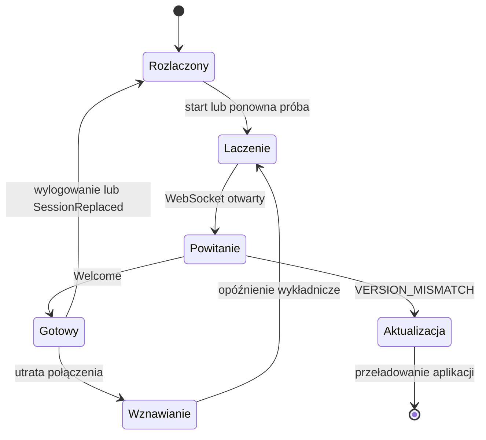

# 10. Klient webowy

**Stan F5:** klient treningu, Worker/WASM i PWA są zaimplementowane. Ten dokument opisuje także przyszłe ekrany online. Bieżący zakres, pomiary i ograniczenia: [raport F5](21-trening-offline-testy.md).

Klient to aplikacja SolidJS w TypeScript, budowana przez Vite i instalowalna jako PWA (ADR-004). Rozgrywka online idzie przez serwer (`07-protokol-sieciowy.md`), a trening offline przez silnik w WebAssembly (`06-silnik-gry.md`, rozdz. 13). Budżety wydajności: `13-wydajnosc.md`.

## 1. Technologie

| Obszar | Wybór | Uwagi |
|---|---|---|
| Język | TypeScript, `strict: true`, `noUncheckedIndexedAccess` | — |
| Interfejs | SolidJS + `@solidjs/router` | podział kodu według tras |
| Budowanie | Vite | hashowane nazwy plików, Brotli i gzip |
| Style | CSS Modules + tokeny w zmiennych CSS (`--color-*`, `--space-*`) | bez biblioteki CSS-in-JS w runtime |
| Protokół | `@bufbuild/protobuf` (kod generowany z `proto/`) | — |
| Teksty | Project Fluent (`@fluent/bundle`) | polska odmiana liczebników |
| Offline | Service Worker (Workbox albo własny) | rozdz. 10 |
| Lint i format | Biome | jedno szybkie narzędzie |
| Testy | Vitest (jednostkowe, komponenty), Playwright (e2e) | `14-testy-i-jakosc.md` |

Zasada: **każda zależność musi mieć uzasadnienie i mieścić się w budżecie rozmiaru**. Nie dodajemy dużych bibliotek komponentów; mały zestaw własnych komponentów jest w `components/ui`.

## 2. Struktura katalogów

```
web/
  index.html            # pakiet gracza
  admin.html            # osobny pakiet panelu administracyjnego
  src/
    app/                # start aplikacji, trasy, granica błędów, motyw
    components/ui/      # przyciski, okna, listy, zakładki, tooltipy, karta czaru, karta postaci
    features/
      auth/ map/ rooms/ chat/ duel/ training/ avatars/ deck/ library/
      shop/ junkyard/ trade/ tournaments/ expeditions/ clans/ mail/
      profile/ ranking/ replay/ settings/ onboarding/
    net/                # klient WebSocket, kodek, korelacja żądań, wznawianie
    state/              # magazyny stanu per domena
    worker/             # most do Web Workera z silnikiem WASM
    platform/           # warstwa platformy: web i android (19-aplikacja-android.md, rozdz. 2)
    i18n/               # ładowanie plików Fluent, formatowanie
    styles/             # tokeny, reset, typografia
    assets/             # ikony SVG (sprite), zoptymalizowane grafiki z art/
    audio/              # generator efektów dźwiękowych (Web Audio API)
  public/               # manifest PWA, ikony aplikacji
```

## 3. Stan aplikacji

- **Serwer jest źródłem prawdy.** Magazyny (`createStore` w Solid) są wypełniane wiadomościami serwera (`Welcome`, migawki, delty) i nie są modyfikowane „na zapas” w odpowiedzi na kliknięcia. Wyjątkiem są lokalne szkice: ustawienia ruchu w walce czy budowana talia. Szkic jest osobnym stanem do momentu wysłania.
- Magazyny domenowe: `session`, `profile`, `avatars`, `collection`, `decks`, `wallet`, `rooms`, `chat`, `challenges`, `duel`, `trade`, `tournaments`, `expedition`, `clan`, `social`.
- Dane treści (karty, postacie, teksty) ładuje się raz z `content.<hash>.json` i trzyma jako niezmienne mapy.
- Pamięć przeglądarki (`localStorage`) tylko na wygodę: ustawienia dźwięku, język, ostatni pokój, zwinięte panele. Każdy odczyt i zapis jest w `try/catch`, a aplikacja działa poprawnie bez niej.

## 4. Warstwa sieciowa



- Jedno połączenie na kartę przeglądarki. Druga karta przejmuje sesję (`SessionReplaced`), a pierwsza pokazuje komunikat „gra otwarta w innym oknie”.
- **Żądania:** `request(msg) → Promise<odpowiedź>` korelowane przez `seq`, z limitem 10 s. Operacje ekonomiczne niosą `idempotency_key`, więc wolno je bezpiecznie ponowić.
- **Powiadomienia:** rozdzielacz według typu wiadomości do magazynów domenowych.
- **Wznawianie:** opóźnienia 0,5–8 s z losowym rozrzutem, potem `Resume` i migawki (`07-protokol-sieciowy.md`, rozdz. 2). Interfejs pokazuje dyskretny pasek „łączenie…” zamiast blokować ekran.
- **Zegar:** przesunięcie względem `server_time` (mediana z kilku pomiarów `Ping`/`Pong`) służy tylko do wyświetlania liczników. O limitach decyduje serwer.

## 5. Ekrany

| Ekran | Najważniejsze elementy | Reguły |
|---|---|---|
| Logowanie i rejestracja | formularze, wybór szkoły startowej z podglądem zestawu | R-KNT-01 |
| Mapa | lokacje: Arena, Trening, Zamek, Portal, Bazar, Klany, Sklep, Wieża; panel postaci (wybór postaci, talia, poczta, opcje, punkty rozwoju) | R-LOB-01 |
| Pokój | lista graczy (sortowanie: ranking, poziom, nazwa), czat z filtrami kanałów, ostatnie pojedynki, filtr wyzwań, przycisk wyzwania | R-LOB-02…05, R-KOM |
| Okno wyzwania | karta postaci przeciwnika, ranking, tytuł, klan, statystyki, opis, licznik 30 s | R-LOB-04 |
| Walka | rozdz. 6 | rozdz. 4 zasad |
| Powtórka i ekran końca | odtworzenie zdarzeń, wynik, PD, zmiana rankingu, nagrody; link do strony walki | R-KON, R-RNK, R-PD |
| Postacie | 10 slotów, tworzenie z odblokowanych szablonów, aktywacja, usuwanie z potwierdzeniem | R-PUL |
| Rozwój postaci | statystyki, poziom, PD, wydawanie PR, reinkarnacja (wybór drogi, specjalizacji, daru), tworzenie cienia | R-ROZ, R-REI, R-CIE |
| Konstruktor talii | biblioteka (filtry: szkoła, rzadkość, koszt, „tylko grywalne”), talia 20/20, kopie ≤ 4, zapisane zestawy, symulacja dobrania 5 + 5 kart | R-TAL |
| Biblioteka czarów (Wieża) | wszystkie karty z liczbą posiadanych, sortowanie (ilość, nazwa, rzadkość, wymagania) | — |
| Wysypisko (Wieża) | wybór kart do wyrzucenia, licznik punktów, nagroda | R-WYS |
| Sklep | zestawy z cenami i jawnymi szansami, lista nieotwartych, animacja otwierania (zakładki: brązowe, srebrne, złote) | R-SKL |
| Bazar i wymiana | zaproszenia, okno wymiany z dwiema ofertami, Dukaty, akceptacje (reset przy zmianie) | R-WYM |
| Zamek (turnieje) | lista turniejów, tworzenie, zapisy, drabinka z kolorami stanów, zegary | R-TUR |
| Portal (wyprawy) | wybór trudności, etap z 3 przeciwnikami (kolory trudności), zebrane PD, wycofanie, nagroda | R-WYP |
| Klany | lista i profil klanu, wnioski, zarządzanie rolami, pokój klanowy | R-KLA |
| Profil i ranking | profil publiczny, historia walk, ranking graczy i klanów | R-RNK |
| Poczta, znajomi, ignorowani | — | R-KOM-02, R-KOM-04 |
| Ustawienia | język, dźwięk, animacje (pełne, skrócone, bez), powiadomienia, konto (eksport danych, usunięcie) | — |
| Samouczek | prowadzony trening z botem: ustawienia, koncentracja, czar, combo, wynik | — |

Nawigacja główna (`app/Shell.tsx`) to ikony z podpisami (`art/icons/nav-*`). Na telefonie (do 650 px) tworzy pasek przyklejony do dolnej krawędzi ekranu, jak w grach mobilnych. Na tablecie (do 960 px) zajmuje osobny rząd pod nazwą gry. Ekrany sieciowe pokazują ikonami zamiast skrótów poziom, RP, Dukaty, statystyki i stany graczy (AFK, zajęty). Nazwa wartości zostaje w tekście alternatywnym i podpowiedzi. Ikony ekranów sieciowych (`art/icons/online/`, `app/onlineIcons.ts`) nie trafiają do pakietu offline. Lista graczy i boty treningowe mają małe portrety postaci.

Każdy ekran zaczyna się obrazem swojego miejsca w złoconej ramie z tytułem na tabliczce (`components/Scene.tsx`, `art/paintings/scenes`). Mają go Kolekcja, Sklep, Klany, Konto i Ustawienia, a w Zamku także panel turniejów. Kolekcja, Sklep i Klany są w mieście budynkami, więc w rogu obrazu mają okrągły przycisk powrotu do mapy (`components/BackToMap.tsx`), taki sam jak wnętrza lobby. Na ekranie startowym obraz wypełnia kartę powitalną pod zasłoną od strony tekstu. Każdy ekran pobiera tylko swoją scenę, więc sceny ekranów sieciowych nie trafiają do pakietu offline. Biblioteka czarów w Kolekcji pokazuje ilustracje kart (`app/cardArt.ts`, ładowany jak w walce).

## 6. Ekran walki

### 6.1. Układ

```
┌───────────────────────────────────────────────────────────────┐
│ [Twoja postać]  Ż ███████ 80%   runda 2/5 ● inicjatywa  0:47  │
│ AF 6 OF 1 AM 3 OM 2  W ████ 50   K 5                          │
│ umagicznienia: …                                              │
├──────────────────────────────┬────────────────────────────────┤
│ TWOJE ATAKI   [F][M][F]      │ TWOJE OBRONY   [M][F][M]       │
│ jego obrony z poprz. rundy   │ jego ataki z poprz. rundy      │
│     f  m  f                  │     m  m  f                    │
├──────────────────────────────┴────────────────────────────────┤
│ RĘKA:  [karta1] [karta2] [karta3] [karta4] [karta5]           │
│ koszt ruchu: K 2 + 1 = 3 / 5   W czaru 4   przewidywane W −10 │
│            [ Zatwierdź ruch ]   [ Powtórka ]   [ Ucieczka ]   │
├───────────────────────────────────────────────────────────────┤
│ [Postać przeciwnika]  Ż 100%  W …  K …  umagicznienia: …      │
└───────────────────────────────────────────────────────────────┘
```

Na telefonie w pionie: przeciwnik u góry, sloty ataków i obron w środku (duże pola dotykowe ≥ 44 px), ręka u dołu jako przewijany pasek, a szczegóły karty po długim przytrzymaniu.

### 6.2. Sterowanie

| Akcja | Mysz / dotyk | Klawiatura |
|---|---|---|
| Przełączenie ataku 1–3 | kliknięcie slotu | `1`, `2`, `3` |
| Przełączenie obrony 1–3 | kliknięcie slotu | `4`, `5`, `6` |
| Karta: rzuć → odrzuć → nic | kolejne kliknięcia karty (jak w oryginale, S2) | `Q`, `W`, `E`, `R`, `T` dla kart 1–5 |
| Podgląd karty | prawy przycisk / przytrzymanie | `Shift` + klawisz karty |
| Zatwierdzenie | przycisk | `Enter` |
| Powtórka ostatniej rundy | przycisk | `P` |

Klawisze 1–6 odtwarzają sterowanie klienta J2ME z oryginału (S1).

### 6.3. Zachowanie

- Zmieniony slot ma wyróżnienie (w oryginale kolor czerwony) i ikonę zmiany, nie tylko kolor (dostępność). Licznik K pokazuje koszt na bieżąco. Powrót do ustawienia sprzed rundy zwraca punkt (R-RUN-05).
- Kart, których nie można rzucić (wymagania, K, W, użyta interwencja), nie da się zaznaczyć do rzucenia. Tooltip podaje powód. Odrzucić można każdą kartę.
- Podgląd kosztów i przewidywanego zużycia W liczy silnik WASM w workerze (`preview`), bez zapytań do serwera.
- Po zatwierdzeniu interfejs blokuje zmiany i pokazuje „czekam na przeciwnika”. Gdy przeciwnik wyśle ruch pierwszy: pasek „przeciwnik wysłał ruch” i licznik 60 s (R-RUN-08).
- Pod slotami są miniatury ustawień przeciwnika z poprzedniej rundy (S2/S3).
- Przy rozłączeniu przeciwnika: komunikat z licznikiem 60 s (R-KON-05).

### 6.4. Odtwarzanie rundy

Zdarzenia z `DuelRoundResult` są odtwarzane jako oś czasu animacji:

| Krok | Czas (tempo normalne) |
|---|---|
| ujawnienie ustawień obu stron | 400 ms |
| każdy czar (karta wjeżdża, efekty liczbowe) | 600–900 ms |
| każdy z 6 ataków (wysunięcie, trafienie lub blok, liczba obrażeń, mnożnik combo) | 350–500 ms |
| dobranie karty, podsumowanie | 400 ms |

Ustawienia: tempo ×1, ×2 albo „natychmiast”. Kliknięcie lub `Spacja` przewija do końca rundy. Cała runda w tempie normalnym trwa ok. 4–6 s. Animacje używają wyłącznie `transform` i `opacity` (bez przeliczania układu).

## 7. Renderowanie i animacje

- DOM + CSS. Animacje sekwencyjne przez Web Animations API, przenoszenie kart techniką FLIP.
- `prefers-reduced-motion`: animacje zastąpione przejściami bez ruchu, a oś czasu skrócona do minimum.
- Warstwa efektów cząsteczkowych (np. iskry przy combo ×4) jest opcjonalna i ładowana leniwie. Domyślnie to CSS; Canvas/WebGL tylko jeśli okaże się potrzebny i zmieści się w budżecie.
- Cel: 60 FPS na telefonie średniej klasy. Testy wydajności w CI (`13-wydajnosc.md`).

## 8. Most do silnika (Web Worker)

- Worker ładuje `engine-wasm` leniwie: przy wejściu na ekran walki, treningu albo konstruktora talii. Wcześniej podgrzewa go już wtedy, gdy gracz otworzy okno wyzwania.
- Wymiana danych: bajty Protobuf przez `postMessage` z przekazaniem bufora (transfer, bez kopiowania).
- Funkcje: `trainingStart`, `trainingMove`, `preview`, `validateDeck`, `replay` (`06-silnik-gry.md`, rozdz. 13).
- W walce online worker zna tylko `PlayerView` gracza.

## 9. Zasoby

| Rodzaj | Format | Zasady |
|---|---|---|
| Ilustracje kart i postaci | obrazy z domeny publicznej w AVIF (ADR-021): karta 512 × 320, portret 576 × 384; SVG asystenta (ADR-016) dla kart bez obrazu | w pakiecie offline; zwykle 10–25 KB na obraz |
| Ikony (szkoły, typy ataków, statystyki) | SVG w jednym sprite | dziedziczą kolor, skalują się bez strat |
| Czcionka | jedna czcionka zmienna, podzbiór łaciński z polskimi znakami (`latin-ext`), WOFF2 | `font-display: swap`; alternatywnie czcionki systemowe |
| Dźwięki | efekty generowane przez Web Audio API (bez plików, `03-tresc-gry.md`, rozdz. 9); muzyka opcjonalnie później (Opus i AAC) | kontekst audio uruchamiany po pierwszej interakcji |
| Treść gry | `content.<hash>.json`, `i18n.<lang>.<hash>.json` | cache na stałe (nazwa z hashem) |

## 10. PWA i tryb offline

- `manifest.webmanifest`: `name` „Spellgambit: Arcane Class”, `short_name` „Spellgambit” (`20-nazwa-i-znak-towarowy.md`, rozdz. 1), ikony, `display: standalone`, kolory motywu.
- Service Worker:
  - **precache:** szkielet aplikacji, pakiety JS i CSS, `engine-wasm`, aktualna treść i teksty;
  - **runtime:** grafiki w trybie stale-while-revalidate z limitem rozmiaru cache;
  - API i WebSocket nigdy nie są cache'owane.
- Aktualizacja: nowa wersja instaluje się w tle, a gracz widzi komunikat „dostępna nowa wersja — odśwież”. W trakcie walki komunikat czeka do jej końca. `VERSION_MISMATCH` wymusza odświeżenie.
- Offline działa trening z botami (R-TRE-03) na postaciach i taliach z ostatniej synchronizacji. Pozostałe ekrany pokazują stan „brak połączenia”.

## 11. Języki

- Polski i angielski od początku. Język z ustawień konta, a przy pierwszym wejściu z `navigator.language`.
- Wszystkie teksty interfejsu i treści w plikach Fluent. Liczby i daty przez `Intl`.
- Serwer wysyła kody (błędów, ogłoszeń, nagród) z parametrami, a teksty buduje klient.

## 12. Dostępność

Cel: WCAG 2.2 poziom AA.
- Pełna obsługa klawiaturą (rozdz. 6.2), widoczny fokus, zarządzanie fokusem w oknach dialogowych.
- Typ ataku i obrony oznaczony ikoną i literą (F / M), nie tylko kolorem. Paleta bezpieczna dla daltonistów.
- Wyniki rundy ogłaszane w regionie `aria-live` jako tekst (np. „Twój drugi atak trafił: 7 obrażeń, combo ×2”).
- Kontrast tekstu ≥ 4,5:1. Interfejs działa przy powiększeniu tekstu do 200%.
- Karty mają opis dla czytników ekranu: nazwa, koszty, wymagania, tekst efektu.

## 13. Błędy i telemetria

- Granica błędów na poziomie trasy: błąd jednego ekranu nie zabija aplikacji, a gracz może wrócić na mapę.
- Raportowanie błędów (Sentry lub GlitchTip) bez danych osobowych: usunięte nazwy graczy, treść czatu i adresy e-mail.
- Web Vitals (LCP, INP, CLS) wysyłane w próbce do endpointu telemetrii.
- Inspektor protokołu tylko w buildach deweloperskich (`07-protokol-sieciowy.md`, rozdz. 9).

## 14. Bezpieczeństwo po stronie klienta

- Content Security Policy bez `unsafe-inline` i `unsafe-eval`. Skrypty tylko z własnej domeny, a dla WASM `wasm-unsafe-eval`.
- Tekst od graczy (czat, opisy, nazwy klanów) wyświetlany wyłącznie jako tekst (Solid escapuje domyślnie). Zakaz `innerHTML`. Linki w czacie nie są klikalne.
- Brak sekretów w kodzie klienta. Ciasteczko sesji `HttpOnly`, więc niedostępne dla skryptów.
- Panel administracyjny to osobny pakiet (`admin.html`) pod `/admin`, z ostrzejszą polityką CSP. Pakiet gracza nie zawiera jego kodu.

## 15. Aplikacja Android

Ten sam klient działa w aplikacji Android (Capacitor). Różnice (logowanie tokenem, cykl życia, przycisk „wstecz”, wibracje, aktualizacje paczek) są zamknięte w `src/platform/`, a build dla aplikacji powstaje z `VITE_PLATFORM=android`. W aplikacji nie jest używany Service Worker, bo zasoby są w pakiecie. Szczegóły: `19-aplikacja-android.md`.

## Lobby F6.5

Trasa `#/lobby` ładuje osobny moduł z PL/EN: mapę, listę graczy i profil, czat/komendy, filtry, AFK, znajomych/ignorowanych, pocztę z paginacją i wyzwania. `net/client.ts` obsługuje binarny Protobuf, korelację odpowiedzi, reconnect z rozrzutem 0,5–8 s, resume i przejęcie sesji przez inne urządzenie. `net/commands.ts` zamienia komendy na typowane żądania. Tekst użytkownika jest renderowany jako tekst, bez HTML. Konto i lobby wymagają sieci i są pobierane na żądanie; podstawowy trening, ustawienia i gość pozostają offline. Utrata sieci podczas otwartego lobby zachowuje klienta i jego token wznowienia w RAM.

Mapa to jeden obraz miasta, jak ekran zamku w Heroes 3 albo menu gier mobilnych (`features/lobby/Town.tsx`, ADR-021). Miejsca są budynkami na obrazie (`art/paintings/scenes/town.avif`, obrysy w `art/paintings/town.json`):
- Wieża, Biblioteka, Zamek, Portal, Arena, Klan, Trening, Bazar i Sklep.
- Biblioteka prowadzi do Kolekcji. Klan bez klanu prowadzi do listy klanów.

Budynki do kliknięcia są jasne już w pliku obrazu, a reszta miasta jest przygaszona i rozmyta. W kliencie każdy budynek ma złoty obrys i tabliczkę z nazwą, widoczne także bez najeżdżania, bo na telefonie najeżdżania nie ma. Najechanie albo fokus klawiatury rozjaśnia budynek, pogrubia obrys i pokazuje krótki opis. Gdy na gracza czeka wyzwanie, obrys Areny powoli pulsuje i ma czerwony znaczek, chyba że system prosi o ograniczenie ruchu.

Dostępność i telefony:
- Klawiatura i czytnik ekranu obsługują tabliczki (przyciski z nazwą miejsca). Kształty budynków to dodatkowe cele dla wskaźnika poza kolejnością Tab.
- Na telefonie miasto ma stałą wysokość i przewija się w bok.

Po wejściu do miejsca widać jego obraz w ramie z nazwą i opisem. W rogu jest okrągły przycisk powrotu do mapy, pod obrazem rząd tabliczek z pozostałymi miejscami, a niżej treść miejsca. Tło strony zmienia się wtedy na obraz miejsca, rozmyty i przygaszony, żeby nie konkurował z panelami (`placeBackdrop` w `app/session.ts`, atrybut `data-place`). Zakładka Mapa wraca do miasta bez wychodzenia z pomieszczenia, więc czat i lista graczy zostają.

Pasek gracza nad zakładkami pokazuje portret, poziom i RP, ustawienie wyzwań, AFK i stan połączenia.

## Walka online F7

`features/lobby/OnlineDuel.tsx` renderuje widok otrzymany od serwera, wysyła podgląd i ruch przez istniejący WebSocket i odtwarza własny zapisany ruch po powrocie. `OnlineRecords.tsx` obsługuje ranking, historię i powtórki. Żaden z tych modułów nie jest potrzebny gościowi. Kod lobby/konta jest poza podstawowym precache; API i WebSocket nie trafiają do pamięci Service Workera. [Weryfikacja F7](25-pojedynki-online-testy.md).
