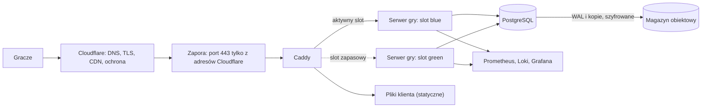
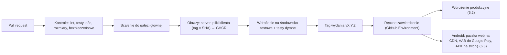

# 15. Infrastruktura i wdrożenie

Dokument opisuje środowiska, topologię produkcji, potok CI/CD, wdrożenia bez przerywania walk, kopie zapasowe, monitoring i procedury awaryjne. Decyzja bazowa: ADR-008 (jeden serwer w UE, Cloudflare, Docker).

## 1. Środowiska

| Środowisko | Gdzie | Wdrażanie | Dane |
|---|---|---|---|
| Lokalne | komputer dewelopera: `docker compose` (PostgreSQL, Mailpit do podglądu e-maili), serwer przez `cargo run`, klient przez `vite dev` | ręcznie | dane testowe ze skryptu |
| CI | kontenery GitHub Actions (usługa PostgreSQL) | automatycznie w każdym PR | tworzone w teście |
| Testowe (staging) | mały VPS, domena `test.<domena>`, dostęp tylko dla zespołu i testerów | automatycznie po scaleniu do gałęzi głównej | dane testowe, okresowo czyszczone |
| Produkcyjne | VPS w UE | po utworzeniu tagu wydania i ręcznym zatwierdzeniu | dane graczy |

## 2. Topologia produkcji



- **Caddy** obsługuje TLS (certyfikat pochodzenia Cloudflare), serwuje pliki klienta i przekazuje `/api` oraz `/ws` do slotu serwera gry.
- **Dwa sloty serwera** (blue i green) pozwalają wdrażać nową wersję obok starej (rozdz. 6).
- **PostgreSQL** na tym samym VPS na starcie; na etapie 2 skalowania na osobnej maszynie (`04-architektura.md`, rozdz. 11).
- **Monitoring** na tym samym VPS albo na osobnym, najmniejszym VPS (zalecane, żeby awaria serwera nie wyłączała alertów).

### 2.1. Ustawienia Cloudflare

| Ustawienie | Wartość |
|---|---|
| SSL/TLS | Full (strict) z certyfikatem pochodzenia na Caddy |
| WebSockets | włączone |
| Cache | `/assets/*`, `/content/*`, `/i18n/*`: cache według nagłówków serwera (immutable); `/api/*` i `/ws`: bez cache; `/api/public/*`: krótki cache (60 s) |
| HTTP/3, Brotli | włączone |
| Ochrona przed botami | Turnstile przy rejestracji; brak wyzwań JS na ścieżce `/ws` (zerwałyby połączenia gry) |
| Reguły zapory | limity zapytań na `/api/auth/*` |

## 3. Rozmiar i koszty (szacunek na start)

| Element | Przykładowa konfiguracja | Koszt miesięczny (orientacyjnie) |
|---|---|---|
| VPS produkcyjny | 4 vCPU, 8–16 GB RAM, NVMe 160 GB | 15–35 € |
| VPS testowy | 2 vCPU, 4 GB RAM | 5–10 € |
| VPS monitoringu | 2 vCPU, 2–4 GB RAM | ok. 5 € |
| Magazyn obiektowy na kopie | 100–200 GB | ok. 5 € |
| Cloudflare | plan darmowy | 0 € |
| E-mail transakcyjny | darmowy próg lub najmniejszy plan | 0–10 € |
| Domena | — | ok. 1 € (10–15 € rocznie) |
| Konto Google Play (organizacja) | jednorazowa opłata rejestracyjna (25 USD według cennika z 2025 r.) i bezpłatny numer D-U-N-S | jednorazowo |
| **Razem** | | **ok. 30–70 €** |

Ceny trzeba sprawdzić w dniu zakupu. Przy wzroście ruchu pierwszym krokiem jest większy VPS (`13-wydajnosc.md`, rozdz. 6).

## 4. Przygotowanie serwera

Konfiguracja jako kod: `deploy/ansible/` (albo cloud-init) zawiera powtarzalne przygotowanie maszyny. Nowy serwer powstaje z jednego polecenia, co jest warunkiem odtworzenia po awarii (rozdz. 9, R4).

- System: aktualne wydanie LTS (Ubuntu LTS lub Debian stable).
- Użytkownik wdrożeniowy z kluczem SSH. Logowanie hasłem i logowanie jako root wyłączone.
- Zapora (nftables lub ufw): SSH tylko z adresów administratora; 80 i 443 tylko z zakresów adresów Cloudflare (lista aktualizowana skryptem).
- Automatyczne poprawki bezpieczeństwa (`unattended-upgrades`), `fail2ban` dla SSH, synchronizacja czasu (`chrony`).
- Docker Engine z wtyczką Compose. Rotacja logów kontenerów.
- Osobny wolumin lub katalog na dane PostgreSQL. Monitoring zajętości dysku.

## 5. Kontenery i konfiguracja

| Usługa | Obraz | Uwagi |
|---|---|---|
| `caddy` | oficjalny Caddy | konfiguracja w `deploy/Caddyfile`; pliki klienta w `/srv/web/<wersja>` z dowiązaniem `current` |
| `game-blue`, `game-green` | `ghcr.io/<repo>/server:<wersja>` (distroless, statyczna binarka) | użytkownik bez roota, system plików tylko do odczytu, `cap_drop: ALL` |
| `postgres` | oficjalny PostgreSQL | wolumin danych, konfiguracja w `deploy/postgres/` |
| `backup` | WAL-G lub pgBackRest | archiwizacja WAL i kopie pełne (rozdz. 7) |
| `node-exporter`, `postgres-exporter`, `alloy` | eksportery metryk i logów | wysyłają dane do VPS monitoringu |

Szkic konfiguracji Caddy:

```
<domena> {
    tls /etc/caddy/origin.pem /etc/caddy/origin-key.pem
    encode zstd gzip

    @immutable path /assets/* /content/* /i18n/*
    header @immutable Cache-Control "public, max-age=31536000, immutable"

    handle /api/* {
        reverse_proxy game-blue:8080 game-green:8080 {
            lb_policy first
            health_uri /readyz
            health_interval 2s
        }
    }
    handle /ws {
        reverse_proxy game-blue:8080 game-green:8080 {
            lb_policy first
            health_uri /readyz
            health_interval 2s
        }
    }
    handle {
        root * /srv/web/current
        try_files {path} /index.html
        file_server
    }
}
```

`lb_policy first` z aktywnym sprawdzaniem `/readyz` kieruje ruch do pierwszego zdrowego slotu. Gdy slot zaczyna wygaszanie (rozdz. 6), jego `/readyz` zwraca 503, więc nowe połączenia trafiają do drugiego slotu, a istniejące WebSockety zostają na starym aż do zamknięcia.

## 6. CI/CD i wdrożenie bez przerywania walk

### 6.1. Potok



- Akcje GitHub przypięte do konkretnych SHA. Tokeny z minimalnymi uprawnieniami. Sekrety produkcyjne dostępne tylko w środowisku `production` z wymaganym zatwierdzeniem właściciela.
- Wdrożenie łączy się z serwerem przez SSH kluczem przeznaczonym tylko do wdrożeń, z ograniczonym zestawem dozwolonych poleceń.

### 6.2. Procedura wdrożenia produkcyjnego

1. **Sprawdzenie kopii:** ostatnia udana kopia pełna młodsza niż 26 h i archiwizacja WAL bez błędów. W przeciwnym razie wdrożenie się zatrzymuje.
2. **Migracje** (tylko zgodne wstecz, tryb expand; `09-baza-danych.md`, rozdz. 5) w jednorazowym kontenerze z rolą `migrator`.
3. **Start nieaktywnego slotu** (np. green) z nowym obrazem. Czekanie, aż `/readyz` zwróci 200.
4. **Pliki klienta:** rozpakowanie do `/srv/web/<nowa-wersja>` i przełączenie dowiązania `current`. Stare wersje zostają 7 dni, żeby otwarte karty mogły doładować swoje fragmenty kodu.
5. **Wygaszanie starego slotu** (blue): `POST /admin/drain` (`08-serwer.md`, rozdz. 9). Nowe połączenia idą do green; blue kończy trwające walki i wymiany (maks. 8 min).
6. **Przekazanie pojedynków:** pojedynki, które nie skończyły się w czasie wygaszania, blue oznacza w `duel_journal` do przejęcia i powiadamia green przez `LISTEN/NOTIFY` w PostgreSQL. Green odtwarza je z dziennika (`08-serwer.md`, rozdz. 5.3), a gracze wznawiają sesje.
7. **Testy dymne na produkcji:** `/healthz`, logowanie konta testowego, `Hello`/`Welcome` przez WebSocket, krótka walka konta testowego z botem.
8. **Zakończenie:** blue zatrzymany; kolejne wdrożenie użyje slotu blue.

**Wycofanie wersji:** ta sama procedura z poprzednim obrazem. Działa, bo migracje są zgodne wstecz (usuwanie kolumn dopiero w kolejnym wydaniu, tryb contract).

### 6.3. Aplikacja Android

Szczegóły aplikacji: `19-aplikacja-android.md`.

| Krok | Kiedy | Opis |
|---|---|---|
| Budowa testowa APK | każdy PR zmieniający `mobile/` lub `web/` | APK debug, test E12 na emulatorze, kontrola rozmiaru |
| Paczka web dla aplikacji | każde wydanie produkcyjne | build klienta z `VITE_PLATFORM=android` → zip → podpis Ed25519 (klucz w środowisku `release`) → `app-bundles/<wersja>.zip` i `manifest.json` na CDN. Manifest jest publikowany **po** przełączeniu serwera (rozdz. 6.2), żeby aplikacje nie pobrały paczki nowszej niż serwer |
| Powłoka (AAB i APK) | tylko przy zmianach natywnych | Gradle buduje AAB i APK release. AAB trafia przez API Google Play (np. Gradle Play Publisher albo fastlane) na ścieżkę testów wewnętrznych, a promocja do produkcji jest ręczna w Play Console. APK z sumą SHA-256 trafia na stronę pobierania |
| Podpisywanie | jak wyżej | klucz przesyłania i klucz podpisu aplikacji tylko w środowisku `release` z ręcznym zatwierdzeniem; konto usługi Google Play z uprawnieniami ograniczonymi do publikacji |

Sekrety Androida: keystore z kluczem podpisu (zakodowany, z hasłem), klucz przesyłania, plik konta usługi Google Play, prywatny klucz Ed25519 do podpisu paczek web. Kopie offline: `19-aplikacja-android.md`, rozdz. 6.

## 7. Baza danych: kopie i odtwarzanie

| Element | Ustalenie |
|---|---|
| Archiwizacja WAL | ciągła, do magazynu obiektowego, szyfrowana po stronie klienta; `archive_timeout = 60 s` |
| Kopie pełne | codziennie (lub co tydzień pełna + codziennie różnicowa) |
| Retencja | 30 dni kopii i WAL |
| Dodatkowo | cotygodniowy zrzut logiczny (`pg_dump`) w osobnym miejscu |
| RPO (maks. utrata danych) | ≤ 5 min |
| RTO (czas odtworzenia) | ≤ 1 h |
| Próba odtworzenia | co miesiąc na osobnej maszynie: odtworzenie do punktu w czasie, kontrola liczby wierszy i uzgodnienie księgi |
| Klucze | klucz szyfrowania kopii przechowywany poza serwerem (menedżer haseł właściciela) |

## 8. Monitoring i alerty

**Narzędzia:** Prometheus (metryki), Loki (logi), Grafana (pulpity i alerty), GlitchTip (błędy serwera i klienta), zewnętrzny sprawdzacz dostępności (np. darmowy plan Better Stack lub UptimeRobot). Alerty przez e-mail i komunikator (np. Telegram lub Discord).

**Metryki serwera** (wybór): `ws_connections`, `room_members`, `duels_active`, `duel_round_latency_seconds` (histogram), `engine_resolve_seconds`, `messages_total{type,direction}`, `rate_limited_total`, `db_query_seconds`, `db_pool_in_use`, `economy_ducats_total{flow=faucet|sink}`, `matches_total{kind,reason}`, `ai_decision_seconds{level}`, `actor_mailbox_depth`, `registrations_total`, `logins_total{result}`.

**Pulpity:** przegląd (połączenia, pojedynki, opóźnienia, błędy), baza danych, ekonomia (źródła i ujścia Dukatów), biznesowy (rejestracje, aktywni gracze dziennie, walki dziennie).

**Alerty:**

| Alert | Warunek | Pilność |
|---|---|---|
| Serwis niedostępny | zewnętrzny test `/healthz` lub połączenia WebSocket nie przechodzi przez 2 min | krytyczna |
| Rozbieżność księgi | saldo ≠ suma księgi | krytyczna |
| Kopia zapasowa | ostatnia kopia starsza niż 26 h albo błędy archiwizacji WAL | wysoka |
| Błędy 5xx | > 1% żądań przez 5 min | wysoka |
| Opóźnienie rundy | p95 > 100 ms przez 15 min | wysoka |
| CPU | > 60% przez 15 min | średnia |
| Pamięć / dysk | > 80% | średnia |
| Pula bazy | > 80% zajętości | średnia |
| Fala błędów klienta | gwałtowny wzrost zdarzeń w GlitchTip | średnia |
| Certyfikat | wygasa za < 14 dni | niska |

**Cele usług (SLO) na start:** dostępność 99,5% w miesiącu (ok. 3,6 h przerwy), wynik rundy p95 ≤ 100 ms.

**Logi:** ustrukturyzowane JSON z `trace_id`, bez danych osobowych; przechowywane 14–30 dni (`12-bezpieczenstwo-i-prawo.md`, rozdz. 7).

## 9. Procedury (runbooki)

| ID | Sytuacja | Najważniejsze kroki |
|---|---|---|
| R1 | Zwykłe wdrożenie | rozdz. 6.2 |
| R2 | Wycofanie wersji | rozdz. 6.2 z poprzednim obrazem; sprawdzenie, czy migracje są zgodne wstecz |
| R3 | Odtworzenie bazy (PITR) | tryb konserwacji → zatrzymanie slotów → odtworzenie do wskazanego czasu na nowym woluminie → uzgodnienie księgi → start → komunikat dla graczy |
| R4 | Awaria serwera | sprawdzenie Cloudflare i konsoli dostawcy → próba restartu → jeśli maszyna nie wraca: nowy VPS z Ansible, odtworzenie bazy (R3), zmiana rekordu DNS w Cloudflare. Cel: ≤ 1 h |
| R5 | Wysokie opóźnienia | CPU i pamięć, wolne zapytania (`pg_stat_statements`), głębokość skrzynek aktorów, obciążenie puli AI → w razie potrzeby blokada nowych pojedynków (tryb konserwacji) |
| R6 | Pełny dysk | logi i stare pliki klienta → retencja WAL → powiększenie woluminu |
| R7 | Rozbieżność księgi | wyłączenie ekonomii flagą (`economy`, `trading`) → analiza wpisów księgi → korekta transakcją administracyjną z wpisem w audycie → ponowne włączenie |
| R8 | Spam lub fala nadużyć | zaostrzenie limitów, tryb wymuszonej CAPTCHA, czasowe wstrzymanie rejestracji, blokady |
| R9 | Wniosek RODO | eksport i usunięcie przez endpointy (`07-protokol-sieciowy.md`, rozdz. 8); ręczna weryfikacja tożsamości przy wnioskach mailowych |
| R10 | Rotacja sekretów | nowe hasło bazy i klucze → aktualizacja sekretów → wdrożenie → unieważnienie starych |
| R11 | Incydent bezpieczeństwa | `12-bezpieczenstwo-i-prawo.md`, rozdz. 10 |
| R12 | Wadliwa paczka web w aplikacji | przywrócenie poprzedniej wersji w `manifest.json` → aplikacje wracają do poprzedniej paczki przy starcie → poprawka i nowa paczka |
| R13 | Wyciek lub utrata klucza Android | wyciek klucza przesyłania: zgłoszenie w Play Console i nowy klucz. Wyciek klucza podpisu: procedura zmiany klucza w Play App Signing i komunikat dla graczy z APK. Utrata klucza podpisu: dalsze wydania tylko przez Google Play, APK spoza sklepu trzeba zainstalować od nowa |

## 10. Zarządzanie wydaniami

- **Wersje:** `vX.Y.Z` dla serwera i klienta (wdrażane razem), osobno wersja protokołu (`07-protokol-sieciowy.md`, rozdz. 7) i `content_version`.
- **Okna serwisowe:** zwykłe wdrożenia bez przerw w dowolnym momencie, poza trwającymi turniejami systemowymi. Prace wymagające przerwy (np. duża migracja) ogłaszane graczom 24 h wcześniej.
- **Flagi funkcji:** nowe funkcje wdrażane wyłączone i włączane po weryfikacji. Ryzykowne funkcje (wymiana, turnieje) można wyłączyć bez wdrożenia.
- **Aktualności dla graczy:** krótka lista zmian w grze (z wydania) i na stronie.
