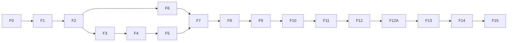

# 16. Plan wdrożenia krok po kroku

Plan prowadzi od pustego repozytorium do publicznego startu. Każdy krok to jeden PR (lub kilka małych), z testami i kryteriami akceptacji. Kolejne kroki zaczyna się dopiero po spełnieniu kryteriów poprzednich.

**Założenia szacunków:** jedna doświadczona osoba na pełen etat. Grafiki tworzy asystent AI w krokach F3.6, F9.5, F10.6 i F12A (ADR-016), a szacunki obejmują czas na przegląd i poprawki z właścicielem. Szacunki są orientacyjne; po fazie F1 trzeba je przeliczyć według rzeczywistego tempa. Przy dwóch osobach fazy klienta (F5, część F8–F11) i aplikacja Android (F12A) mogą iść równolegle z serwerem.

## Kamienie milowe

| Kamień | Co działa | Po fazie | Szacunek (narastająco) |
|---|---|---|---|
| **M0** | repozytorium, CI, szkielety projektów | F0 | 1 tydz. |
| **M1** | silnik: pełna walka z kartami startowymi w CLI, test TR-01 zielony, boty L0–L1 | F1–F2 | 6 tydz. |
| **M2** | pierwsza grywalna wersja: trening offline z AI w przeglądarce (PWA), pierwsze grafiki | F3–F5 | 14 tydz. |
| **M3** | alfa online: konta, lobby, czat, pojedynki PvP, ranking, PD | F6–F7 | 21 tydz. |
| **M4** | beta zamknięta: pula postaci, rozwój, talie, kolekcja, Dukaty, sklep, wysypisko, wymiana | F8–F9 | 28 tydz. |
| **M5** | wersja kompletna: pełna treść z grafikami, reinkarnacje, cienie, turnieje, wyprawy, klany, administracja | F10–F12 | 44 tydz. |
| **M5A** | aplikacja Android w teście zamkniętym Google Play i jako testowy APK | F12A | 48 tydz. |
| **M6** | start publiczny: przeglądarka, Google Play i APK; utwardzenie, testy obciążeniowe, produkcja | F13–F14 | 53 tydz. |
| **M7** | eksploatacja: balans, nowe dodatki, opcjonalnie płatności | F15 | ciągle |

Ścieżka krytyczna: F0 → F1 → F2 → F6 → F7 → F8 → F9 → F11 → F12A → F13 → F14. Fazy F3–F5 (treść, AI, klient offline) mogą iść równolegle z F6, a F12A równolegle z F10–F12, jeśli pracują dwie osoby.

---

## F0. Przygotowanie (≈ 1 tydz.)

| Krok | Zadania | Kryteria akceptacji |
|---|---|---|
| F0.1 Struktura repo | układ katalogów z `04-architektura.md`, rozdz. 7; `.gitignore` dla Rust/Node (zastąpić obecny szablon Visual Studio); `README`, `CONTRIBUTING`, `CODEOWNERS` | `cargo check` i `pnpm install` przechodzą na czystym klonie |
| F0.2 Narzędzia i wersje | ustalenie wersji: Rust (`rust-toolchain.toml`), Node LTS, pnpm, PostgreSQL; `Cargo.lock`, `pnpm-lock.yaml`; Renovate | wersje zapisane w repo, Renovate otwiera pierwszy PR |
| F0.3 CI | GitHub Actions: `fmt`, `clippy -D warnings` (z zakazami z `06-silnik-gry.md`, rozdz. 7), testy Rust, `biome`/`tsc`, testy web, `buf lint`; cache | PR z błędem formatowania jest blokowany |
| F0.4 Szkielety | puste crate'y (`engine`, `engine-cards`, `engine-content`, `engine-ai`, `engine-wasm`, `protocol`, `server`, `content-compiler`, `sim`, `loadtest`), projekt `web` (Solid + Vite), `e2e` (Playwright) | każdy pakiet buduje się w CI |
| F0.5 Lokalne środowisko | `deploy/docker-compose.dev.yml` (PostgreSQL), skrypt startowy | `docker compose up` + `cargo run -p server` odpowiada na `/healthz` |
| F0.6 Konwencje | konwencja commitów, szablon PR z checklistą (`14-testy-i-jakosc.md`), ADR w repo | szablony w `.github/` |
| F0.7 Marka | zadanie firmy, równolegle z F0.1–F0.6: domeny spellgambit.pl, .eu i .gg; zgłoszenie znaku słownego SPELLGAMBIT w EUIPO w kl. 9 i 41 (`20-nazwa-i-znak-towarowy.md`, rozdz. 6; termin: P-13) | domeny zarejestrowane na firmę; numer zgłoszenia EUIPO wpisany do P-13 |

## F1. Silnik: rdzeń walki, karty bez efektów (≈ 2 tydz.)

| Krok | Zadania | Kryteria akceptacji |
|---|---|---|
| F1.1 Typy i konfiguracja | typy z `06-silnik-gry.md`, rozdz. 3; `RulesConfig` wczytywany z TOML | testy deserializacji `rules.toml` |
| F1.2 Przygotowanie pojedynku | snapshot, stan początkowy, tasowanie (strumienie RNG), ręka, inicjatywa, ustawienia domyślne (R-POJ-01…06) | testy jednostkowe dla każdej reguły R-POJ |
| F1.3 Runda z kartami bez efektów | koszty zmian; rzucanie kart z opłatą K i W, wymaganiami szkół i limitem interwencji; odrzucanie i dobieranie kart w kolejności inicjatywy; faza ataków, blok, combo, koszt W, brak W (R-RUN-01…06, R-RUN-09…12, R-RUN-14, R-RUN-15, R-ATK-01…07) | przykład z `02-zasady-gry.md`, rozdz. 14 jako test (czar „+2 do AM” jako karta bez efektu); rundy 1–2 testu TR-01; wszystkie reguły R-ATK mają testy |
| F1.4 Koniec pojedynku | nokaut, remis, procent życia, ucieczka, timeout (R-KON-01…05) | testy wszystkich ścieżek końca |
| F1.5 Walidacja i podgląd | `validate_move`, `preview`, `default_move`, kody `MoveError` | testy błędów dla każdego kodu |
| F1.6 Determinizm i powtórki | `state_hash`, `ReplayRecord`, `replay()`; test natywne = WASM | 10 000 losowych pojedynków: ten sam hash natywnie i w WASM |
| F1.7 Testy właściwościowe i benchmark | `proptest` (niezmienniki), `criterion` | `resolve_round` ≤ 5 µs (mediana) natywnie |

**Korekta zakresu (2026-10-14).** Kryteria F1.3 (przykład z rozdz. 14 zawiera rzucenie czaru) i F1.5 (kody błędów o wymaganiach szkół i interwencjach) potrzebują podstaw obsługi kart. Dlatego w F1 są koszty kart, wymagania szkół, interwencje, ręka, odrzucanie i dobieranie. W F2 zostają efekty, umagicznienia i pozostałe słowa kluczowe.

## F2. Silnik: system kart (≈ 3 tydz.)

| Krok | Zadania | Kryteria akceptacji |
|---|---|---|
| F2.1 Efekty czarów | wykonanie efektu przy rzuceniu i trwałe zmiany statystyk (R-CZA-01), czar przepadający przy rozpatrzeniu (Z-SPW), efekty na koniec rundy (R-RUN-13); rzucanie, opłaty, odrzucanie i dobieranie są od F1.3 | testy reguł |
| F2.2 Rodziny efektów | `stat_mod`, `stat_set`, `swap_stats`, `heal`, `damage`, `stamina`, `focus`, `drain`, `force_hit`, `force_miss`, `unblockable`, `swap_choices`, `damage_taken_mult`, `school_mod`, `hand`, `dispel` | test każdej rodziny |
| F2.3 Umagicznienia | rejestracja, wyzwalacze, kolejność, rozpraszanie (R-CZA-02) | testy wyzwalaczy |
| F2.4 Słowa kluczowe | przeciwzaklęcie, sprzężenie, karta losowa, warunki, specjalizacje (R-CZA-04…09; interwencja od F1.3) | testy reguł; Z-CNT i Z-ENG-1…4 zatwierdzone |
| F2.5 Test referencyjny | TR-01 (walka #26519, rundy 1–3; rundy 1–2 z kartami bez efektu są testowane od F1.3) | TR-01 zielony |
| F2.6 Boty L0–L1 i CLI | bot losowy i heurystyczny; `sim` rozgrywa pojedynki w konsoli | **M1:** 100 000 pojedynków botów bez paniki; raport z CLI |

**Stan (2026-10-15).** Kroki F2.1–F2.6 zrobione. Rozpraszanie (`dispel`) jest w F2.3 razem z umagicznieniami. `sim run --n 100000` rozgrywa 100 000 pojedynków bez paniki dla par botów L1–L1, L1–L0 i L0–L0; L1 wygrywa z L0 ok. 62% pojedynków. Nowe decyzje Z-ENG-5, Z-ENG-6 i pozostałe z `06-silnik-gry.md`, rozdz. 5 czekają na zatwierdzenie.

## F3. Treść, narzędzia i pierwsze grafiki (≈ 3 tydz.)

| Krok | Zadania | Kryteria akceptacji |
|---|---|---|
| F3.1 Format treści | schematy TOML i Fluent z `03-tresc-gry.md`, rozdz. 8 | przykładowe pliki przechodzą walidację |
| F3.2 Kompilator treści | walidacja, generowanie `engine-content`, JSON dla klienta, `content_version` | celowo zepsute pliki dają czytelne błędy |
| F3.3 Treść MVP | 6 szkół, 6 postaci startowych (własne nazwy), ok. 72 karty z zestawów startowych, zestawy startowe, zasady | każda karta ma test scenariuszowy |
| F3.4 Generator krzywych | narzędzie z `03-tresc-gry.md`, rozdz. 3.2 | krzywe 6 postaci w zakresach z tabeli |
| F3.5 Raport balansu | `sim`: macierz wygranych postaci startowych (boty L1) | żadna postać startowa > 60% wygranych |
| F3.6 Przewodnik stylu i pierwsze grafiki | asystent AI przygotowuje w SVG: przewodnik stylu (paleta, typografia, układ karty), ikony 6 szkół, typów ataku i statystyk, ramki kart według rzadkości, 6 postaci startowych (`03-tresc-gry.md`, rozdz. 9) | właściciel zatwierdza przewodnik i grafiki; pliki w `art/`; wpisy w rejestrze pochodzenia |

**Stan (2026-10-15).** Kroki F3.1–F3.6 zrobione; grafiki z F3.6 zatwierdził właściciel.
- F3.1–F3.2: `content-compiler` (`check`, `build`, `curves`), `engine-content` z wygenerowanym kodem, `content.json` i teksty dla klienta, krok „Treść: walidacja” w `check.bat` i CI.
- F3.3: 72 karty, 6 postaci startowych i 6 zestawów startowych z tekstami PL i EN; każda karta ma test scenariuszowy.
- F3.4: generator krzywych; krzywe 6 postaci mieszczą się w zakresach z `03-tresc-gry.md`, rozdz. 3.2.
- F3.5: `sim matrix` (2000 i 10 000 pojedynków na parę, boty L1): postacie startowe mają 43,8–56,2% wygranych, więc żadna nie przekracza 60%. Pojedyncze pary są nadal jednostronne (np. Strażnik Świtu przeciw Mistrzowi Trybów ok. 94%), co trzeba obserwować przy kolejnych zmianach treści i botów. Krok „Balans” w `check.bat` i CI (500 pojedynków na parę).
- F3.6: przewodnik stylu `art/README.md`, ikony, ramki kart, układ karty i portrety w `art/`, galeria `art/gallery.html`, rejestr `art/PROVENANCE.md`.

## F4. AI (≈ 2 tydz.)

| Krok | Zadania | Kryteria akceptacji |
|---|---|---|
| F4.1 L2: model przeciwnika | statystyki zachowań przeciwnika, kontrstrategia | L2 wygrywa z L1 ≥ 60% przy równych postaciach |
| F4.2 L3: gra macierzowa | przeszukiwanie z próbkowaniem ręki przeciwnika, rozwiązywanie strategii mieszanej | L3 wygrywa z L2 ≥ 55%; decyzja ≤ 50 ms natywnie |
| F4.3 Profile botów | poziomy trudności, osobowości, talie botów (`bots.toml`) | 4 poziomy trudności w treningu |

**Stan (2026-10-15).** Kroki F4.1–F4.3 zrobione. `engine-ai` udostępnia L0–L3 oraz cztery profile treningowe z `content/bots.toml`; ich wybór w interfejsie dojdzie z ekranem treningu F5.5.
- F4.1: model ujawnionych przejść ustawień, prior Dirichleta, ograniczenie przez K i softmax w stałym przecinku. `sim ai --n 1200` (poziom 1, ziarno 0): L2 wygrał 766/1200 walk z L1, czyli 63,8% (próg 60%).
- F4.2: 8 próbek kart, do 24 kandydatów na stronę, rozstrzygnięcia prawdziwym silnikiem i 1000 iteracji regret matching. L3 wygrał 689/1200 walk z L2, czyli 57,4% (próg 55%); p95 decyzji poniżej 10 ms natywnie w release (limit 50 ms).
- F4.3: profile Nowicjusz, Uczeń, Taktyk i Arcymag, nazwy PL/EN, parametry osobowości, cztery archetypy talii i rotacja sześciu postaci startowych. Testy legalności, powtarzalności, uczciwości i zgodności natywne/WASM; hierarchia AI kontrolowana przez `check.bat` i CI. Szczegóły i ograniczenia pomiaru w `11-ai-i-symulacje.md`.

**Po przeglądzie F4 (2026-10-15).** Poprawiono siedem zgłoszonych problemów: podwójne premie przy zmianie statystyk, warunki kart w AI, kontrolę siły rzeczywistych profili, próbkowanie losowych uzupełnień talii, uczenie z ostatniej rundy, niepełny hash umagicznień i utratę wymuszonych wyników ataków. Silnik ma wersję 0.2.0. Dodano testy regresji i rozszerzono `sim ai` do czterech serii po 1200 walk. Profile z własnymi taliami: Taktyk–Uczeń 63,2%, Arcymag–Taktyk 56,0%; obie pary przekraczają progi. Pełne `check.bat` przeszło bez pominięć, łącznie z Node/WASM, e2e i serwerem z PostgreSQL.

## F5. Klient: trening offline (≈ 3 tydz.) → M2

| Krok | Zadania | Kryteria akceptacji |
|---|---|---|
| F5.1 Szkielet aplikacji | routing, i18n (PL/EN), tokeny stylu, komponenty bazowe | Lighthouse ≥ 95 na pustej aplikacji |
| F5.2 Worker WASM | `engine-wasm`, protokół worker ↔ UI (`06-silnik-gry.md`, rozdz. 13) | pojedynek bota przeciw botowi w workerze |
| F5.3 Ekran walki | ustawienia ataków i obron (klawisze 1–3, 4–6), ręka, koszty, podgląd W, licznik, umagicznienia, inicjatywa | ruch możliwy myszą, dotykiem i klawiaturą |
| F5.4 Animacja rundy | odtwarzanie zdarzeń, powtórka rundy, ekran końca | 60 FPS na telefonie średniej klasy |
| F5.5 Trening i PWA | wybór postaci startowej i bota, Service Worker, tryb offline | **M2:** gra offline po instalacji PWA; test e2e „trening do końca” |
| F5.6 Test na telefonie | wczesna wersja aplikacji Capacitor (debug) z treningiem offline; pomiary na 2–3 telefonach z macierzy (`19-aplikacja-android.md`, rozdz. 10) | start ≤ 2 s, 60 FPS w walce, silnik WASM działa w WebView; problemy wpisane do rejestru ryzyk |

**Stan F5 (2026-10-15).** Zaimplementowano F5.1–F5.5: routing, PL/EN, jasny/ciemny motyw, worker Protobuf/WASM, pełny trening, podgląd kosztów z Rust, animacje i powtórkę rundy, PWA i offline. Testy przechodzą w Chromium oraz emulacji Pixel 5, w tym pełna walka po odłączeniu sieci i przeładowaniu strony. Lighthouse mobile: 100/100/100/100; budżety rozmiaru sprawdzane przy budowaniu. W F5.6 zbudowano APK debug i rozegrano trening bez sieci w WebView 113 na emulatorze Android 14. **F5.4/F5.6 pozostają otwarte w części sprzętowej:** 60 FPS i start do interaktywności wymagają pomiarów na 2–3 fizycznych telefonach; pierwszy start aktywności emulatora wyniósł 3,4 s. Szczegóły: [raport F5](21-trening-offline-testy.md).

## F6. Serwer: konta, połączenie, lobby (≈ 3,5 tydz.)

| Krok | Zadania | Kryteria akceptacji |
|---|---|---|
| F6.1 Baza i migracje | schemat kont, sesji, postaci, kolekcji, ratingów (`09-baza-danych.md`) | migracje w CI na czystej bazie |
| F6.2 Konta | rejestracja, logowanie, wylogowanie, weryfikacja e-mail, reset hasła (ADR-010, R-KNT-01…02); lokalny gość bez API i zapisu danych (ADR-018, R-KNT-04); od razu także ścieżka aplikacji: token, bilet WebSocket, wymiana tokenu, CORS dla pochodzenia aplikacji (ADR-015) | testy integracyjne obu ścieżek logowania; limity prób; gość działa offline bez zapisu |
| F6.3 Gateway WebSocket | sesje, `Hello`/`Welcome`, puls, wznawianie, limity (rozdz. 1–6 w `07-protokol-sieciowy.md`) | test: 1000 połączeń lokalnie bez błędów |
| F6.4 Pokoje i czat | aktory pokojów, obecność, czat, filtry, znajomi i ignorowani, poczta | testy e2e czatu dwóch klientów |
| F6.5 Klient: logowanie i lobby | ekrany logowania, mapy, pokoju, czatu, komendy czatu | test e2e „rejestracja → lobby” |

**Stan F6 (2026-10-15).** F6.1 wykonany: cztery migracje tworzą dziewięć tabel kont, sesji, postaci, kolekcji, talii i rankingu. Testy PostgreSQL obejmują pustą bazę, aktualizację z istniejącymi danymi, ponowne uruchomienie, ograniczenia, współbieżne zajęcie slotu i uprawnienia ról. CI sprawdza także metadane SQLx. Normalny start serwera nie wykonuje DDL; `run.bat` wcześniej wywołuje osobne polecenie migracji. Szczegóły: [raport F6.1](22-baza-migracje-testy.md).

**Aktualizacja F6.2 (2026-10-15).** Zaimplementowano rejestrację z zestawem startowym, logowanie i wylogowanie web/aplikacji, sesje i ich unieważnianie, potwierdzanie e-maila, reset hasła, rotację tokenu, bilet WebSocket, CORS i limity prób. Dodano formularze konta oraz lokalnego gościa bez API i zapisu danych (decyzja właściciela, ADR-018). Testy akceptacyjne obejmują obie ścieżki logowania i tryb gościa offline. SMTP i Turnstile wymagają konfiguracji przed wdrożeniem publicznym. Następny krok: F6.3. Szczegóły i granice: [raport F6.2](23-konta-i-gosc-testy.md).

## F7. Pojedynki online (≈ 3 tydz.) → M3

| Krok | Zadania | Kryteria akceptacji |
|---|---|---|
| F7.1 Wyzwania | wysyłanie, przyjmowanie, wygasanie, filtry (R-LOB-03…06) | testy integracyjne |
| F7.2 Aktor pojedynku | automat stanów, limity czasu, ruchy domyślne, ucieczka, rozłączenie, dziennik rund, odtworzenie po restarcie | test chaosu: restart serwera w trakcie walki, walka trwa dalej |
| F7.3 Wynik | ranking (R-RNK), PD (R-PD), statystyki gracza, historia walk z powtórką | wzór rankingu zgodny z tabelą z `01-badania-i-zrodla.md`, rozdz. 5.1 |
| F7.4 Trening online | boty „AI” w sali treningowej (R-TRE-01…02) | bot odpowiada od razu |
| F7.5 Klient online | ekran walki online, `DuelSnapshot` po wznowieniu, profil i ranking | **M3:** dwie osoby rozgrywają pełną walkę przez internet (środowisko testowe) |

## F8. Postacie i kolekcja (≈ 3 tydz.)

| Krok | Zadania | Kryteria akceptacji |
|---|---|---|
| F8.1 Pula postaci | tworzenie, usuwanie, aktywacja, 10 slotów (R-PUL) | testy reguł |
| F8.2 Poziomy i PR | awanse, wydawanie PR (R-ROZ) | testy reguł |
| F8.3 Kolekcja i talie | kolekcja, talie, zapisane zestawy, przycinanie (R-TAL) | testy reguł |
| F8.4 Zdobywanie postaci | nagrody na arenie, gwarancje dla nowych graczy (R-NAG-01) | test statystyczny szans |
| F8.5 Klient | ekrany postaci, rozwoju, konstruktora talii, biblioteki czarów | test e2e „nowa postać → talia → walka” |

## F9. Ekonomia i treść bety (≈ 4 tydz.) → M4

| Krok | Zadania | Kryteria akceptacji |
|---|---|---|
| F9.1 Dukaty i księga | portfel, księga transakcji, źródła z R-EKO-01 | uzgodnienie salda z księgą (zadanie okresowe) |
| F9.2 Sklep | zestawy kart, otwieranie, jawne szanse (R-SKL) | test statystyczny zawartości; idempotencja zakupów |
| F9.3 Wysypisko | punkty i postacie specjalne (R-WYS) | testy reguł |
| F9.4 Wymiana | aktor wymiany, wersje ofert, atomowa transakcja (R-WYM) | test współbieżności: brak duplikacji kart przy równoległych operacjach |
| F9.5 Treść beta | +60 kart, +10 postaci, z ilustracjami SVG (`03-tresc-gry.md`, rozdz. 9) | testy scenariuszowe; raport balansu; grafiki zatwierdzone przez właściciela |
| F9.6 Beta zamknięta | środowisko testowe dostępne dla zaproszonych. Równolegle: zgłoszenie znaku SPELLGAMBIT, jeśli nie nastąpiło w F0.7, oraz założenie konta organizacji w Google Play i numeru D-U-N-S, bo weryfikacja może potrwać kilka tygodni | **M4:** 20–50 testerów przez 2 tygodnie; lista błędów |

## F10. Pełna treść i rozwój (≈ 8–10 tydz.)

| Krok | Zadania | Kryteria akceptacji |
|---|---|---|
| F10.1 Reinkarnacje | drogi, specjalizacje, dary (R-REI) | testy reguł |
| F10.2 Cienie | tworzenie, rozwój, reinkarnacja cieni (R-CIE) | testy reguł |
| F10.3 Pełny zestaw kart | ok. 330 kart w 5 edycjach, w paczkach po ok. 30 | każda paczka: testy, raport balansu, przegląd |
| F10.4 Wszystkie postacie | 31 szablonów z drogami | krzywe w zakresach; raport balansu |
| F10.5 Kalibracja tempa | parametry Z-XP, Z-REI, Z-EKO | symulowany czas do poz. 20 i reinkarnacji zgodny z celem projektowym |
| F10.6 Grafiki pełnej treści | ilustracje SVG pozostałych kart, dróg, darów i cieni (`03-tresc-gry.md`, rozdz. 9) | komplet grafik zatwierdzony; wpisy w rejestrze pochodzenia |

## F11. Tryby gry (≈ 4–5 tydz.)

| Krok | Zadania | Kryteria akceptacji |
|---|---|---|
| F11.1 Turnieje | tworzenie, zapisy, drabinka, fazy, punkty, harmonogram, nagrody (R-TUR-01…07, 09) | symulacja turnieju na 32 boty |
| F11.2 Turnieje klanowe | R-TUR-08 | test scenariusza klanowego |
| F11.3 Wyprawy | etapy, wybór przeciwnika, boss, wycofanie, nagrody (R-WYP) | ukończenie każdego poziomu trudności przez bota L3 |
| F11.4 Klany | zakładanie, role, pokój, ranking (R-KLA) | testy reguł |

## F12. Administracja i fair play (≈ 2 tydz.) → M5

| Krok | Zadania | Kryteria akceptacji |
|---|---|---|
| F12.1 Panel administracyjny | gracze, blokady, wyciszenia, turnieje systemowe, ogłoszenia, tryb konserwacji | dostęp tylko z rolą, 2FA i listą IP |
| F12.2 Moderacja | zgłoszenia, dziennik czatu, filtry słów | test e2e zgłoszenia |
| F12.3 Wykrywanie nadużyć | „podkładanie się”, wiele kont, anomalie ekonomii (R-FAI-01) | raport na danych z bety |
| F12.4 Mentorzy | rola i oznaczenie (R-FAI-02) | — |

## F12A. Aplikacja Android (≈ 4 tydz.) → M5A

Szczegóły: `19-aplikacja-android.md`. Logowanie aplikacji powstaje już w F6.2, a wczesny test na telefonach w F5.6.

| Krok | Zadania | Kryteria akceptacji |
|---|---|---|
| F12A.1 Powłoka | projekt Capacitor w `mobile/`, konfiguracja (nazwa aplikacji i stały identyfikator aplikacji, `20-nazwa-i-znak-towarowy.md`, rozdz. 1), warstwa platformy w kliencie (`web/src/platform/`), ikona i ekran startowy (SVG renderowane do PNG) | aplikacja startuje offline i przechodzi trening z botem |
| F12A.2 Integracje natywne | cykl życia i wznawianie, przycisk „wstecz”, stan sieci, wibracje, ekran niegasnący, powiadomienia lokalne (`19-aplikacja-android.md`, rozdz. 3) | scenariusz E12 (wyjście w tło i powrót w trakcie walki) przechodzi |
| F12A.3 Logowanie w aplikacji | token w magazynie Android Keystore, bilet WebSocket, wymiana tokenu, lista aktywnych sesji (ADR-015) | token nie trafia do logów ani do kopii zapasowych Androida |
| F12A.4 Aktualizacje paczek web | manifest, podpis Ed25519, pobieranie w tle, wycofanie po nieudanym starcie (`19-aplikacja-android.md`, rozdz. 5) | wszystkie testy aktualizacji z `19-aplikacja-android.md`, rozdz. 11 |
| F12A.5 Budowanie i podpisywanie | CI: APK debug w PR-ach; AAB i APK release w chronionym środowisku; klucze z kopiami offline (`15-infrastruktura-i-wdrozenie.md`, rozdz. 6.3) | podpisane AAB i APK z sumami SHA-256 |
| F12A.6 Testy urządzeń | macierz urządzeń, budżety z `19-aplikacja-android.md`, rozdz. 10, raport przedpremierowy Google Play | budżety spełnione, brak błędów krytycznych |
| F12A.7 Google Play | karta sklepu PL i EN z tytułem „Spellgambit: Arcane Class” i grafikami (ikona, grafika promocyjna, zrzuty ekranu), „Bezpieczeństwo danych”, klasyfikacja IARC, test zamknięty z testerami bety | **M5A:** aplikacja w teście zamkniętym Google Play; testowy APK dostępny dla testerów |

## F13. Utwardzenie (≈ 3 tydz.)

| Krok | Zadania | Kryteria akceptacji |
|---|---|---|
| F13.1 Testy obciążeniowe | boty `loadtest`: lobby, pojedynki, turnieje, burza ponownych połączeń | budżety z `13-wydajnosc.md` spełnione na docelowym serwerze |
| F13.2 Wydajność klienta | budżety rozmiaru, Lighthouse CI, test na słabym telefonie | LCP ≤ 1,5 s; INP ≤ 100 ms |
| F13.3 Bezpieczeństwo | przegląd zagrożeń, skan zależności, test penetracyjny podstawowy (ZAP), przegląd uprawnień | brak krytycznych i wysokich problemów |
| F13.4 Dostępność | WCAG 2.2 AA (axe, klawiatura, czytnik ekranu) | brak błędów krytycznych axe |
| F13.5 Prawo | regulamin, polityka prywatności, eksport i usuwanie danych, przegląd nazw i grafik, konsultacja prawna | dokumenty opublikowane; zgoda prawnika |

## F14. Produkcja i start (≈ 2 tydz.) → M6

| Krok | Zadania | Kryteria akceptacji |
|---|---|---|
| F14.1 Infrastruktura | VPS, utwardzenie systemu, Docker, Caddy, Cloudflare, DNS (`15-infrastruktura-i-wdrozenie.md`) | środowisko produkcyjne i testowe działają |
| F14.2 CI/CD | obrazy w GHCR, automatyczne wdrożenie na środowisko testowe, ręczne zatwierdzenie produkcji, wdrożenie bez przerywania walk | wdrożenie w trakcie walk testowych: żadna walka nie została przerwana |
| F14.3 Kopie i odtwarzanie | WAL-G/pgBackRest do S3, PITR, próba odtworzenia | odtworzenie bazy na czystej maszynie < 1 h |
| F14.4 Monitoring | metryki, logi, alerty, uptime, śledzenie błędów | alert testowy dociera do właściciela |
| F14.5 Beta otwarta i start | beta otwarta (2–4 tyg.), poprawki, start wersji w przeglądarce | checklista startowa zaliczona |
| F14.6 Publikacja aplikacji | promocja wersji z testu zamkniętego do produkcji w Google Play; strona pobierania APK z sumą SHA-256; paczka web zgodna z wydaniem serwera | **M6:** gra dostępna w przeglądarce, w Google Play i jako APK; aktualizacja paczki web działa na produkcji |

**Checklista startowa:** kopie zapasowe działają i są przetestowane; alerty skonfigurowane; tryb konserwacji przetestowany; regulamin i polityka prywatności opublikowane; procedury awaryjne spisane (w tym R12 i R13 dla aplikacji); limit rejestracji i ochrona przed botami włączone; klucze podpisu aplikacji mają kopie offline; plan komunikacji z graczami gotowy.

## F15. Eksploatacja (ciągle)

- Cotygodniowy przegląd telemetrii: wygrane według postaci i kart, tempo progresji, inflacja Dukatów, czasy ruchów.
- Poprawki balansu w małych wydaniach treści.
- Nowe edycje kart co kilka miesięcy (proces z `03-tresc-gry.md`, rozdz. 5.4), z grafikami tworzonymi tak samo jak wcześniej (ADR-016).
- Aplikacja Android: paczka web z każdym wydaniem, nowa powłoka tylko przy zmianach natywnych, coroczna aktualizacja wymaganego poziomu API Google Play.
- Opcjonalnie, po decyzji właściciela: płatności bez losowości (ADR-011; w Google Play przez Google Play Billing), logowanie przez zewnętrznych dostawców, wersja iOS (ta sama powłoka Capacitor; wymaga konta Apple Developer i komputera Mac), powiadomienia push.

## Jak pracować z planem

1. Przed krokiem przeczytaj reguły `R-…` i dokumenty, do których odsyła.
2. Jeden krok = jeden PR (dla dużych kroków kilka PR-ów). Każdy PR z testami i zielonym CI.
3. Kryteria akceptacji sprawdza się przed oznaczeniem kroku jako zakończonego. Nie przechodzi się dalej z czerwonym CI.
4. Każde nowe założenie projektowe trafia do rejestru w `02-zasady-gry.md`, rozdz. 15, a każda zmiana decyzji architektonicznej do nowego ADR.
5. Po każdym kamieniu milowym: przeliczenie szacunków i aktualizacja tego planu.
