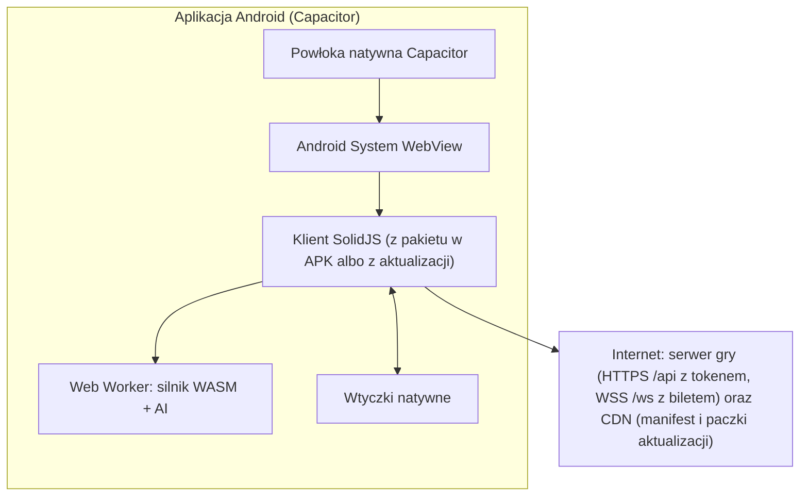
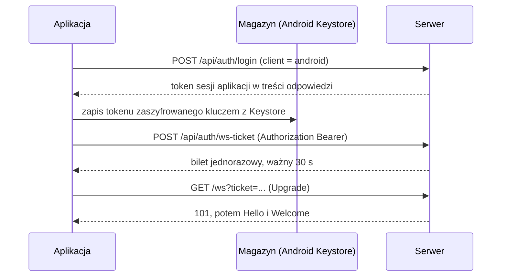

# 19. Aplikacja Android (APK i Google Play)

**Stan F5.6:** powłoka debug buduje się i rozgrywa trening bez sieci w emulatorze Android 14/WebView 113. Pomiary na fizycznych telefonach pozostają otwarte. Procedura i wyniki: [raport F5](21-trening-offline-testy.md). Funkcje logowania, aktualizacji i publikacji opisane dalej należą do F12A.

Gra ma, oprócz wersji w przeglądarce, aplikację na Androida: w Google Play (format AAB) i jako plik APK do pobrania ze strony. Aplikacja to **ten sam klient** (SolidJS + silnik WebAssembly) w natywnej powłoce Capacitor (ADR-014). Logowanie w aplikacji używa tokenu i biletu WebSocket (ADR-015). Oryginalny Cellmons też miał klienta na telefony (Java ME), więc to naturalna kontynuacja.

## 1. Założenia

1. **Jeden kod klienta.** Różnice między przeglądarką a aplikacją są zamknięte w warstwie platformy (`web/src/platform/`), a reszta kodu jest wspólna.
2. **Gra w środku APK.** Interfejs, silnik, treść i teksty są w pakiecie. Aplikacja startuje bez sieci, a trening z botami działa offline od pierwszego uruchomienia.
3. **Szybkie aktualizacje.** Nowe wersje interfejsu i treści trafiają do aplikacji jako podpisane paczki, bez wydawania nowego APK (rozdz. 5). Nowa powłoka jest potrzebna tylko przy zmianach natywnych.
4. **Minimalne uprawnienia** (rozdz. 12).
5. **Te same zasady gry i serwer.** Aplikacja korzysta z tego samego protokołu (`07-protokol-sieciowy.md`).

## 2. Architektura

- Katalog `mobile/` w repozytorium: `capacitor.config.ts` (nazwa aplikacji „Spellgambit” i stały identyfikator aplikacji, `20-nazwa-i-znak-towarowy.md`, rozdz. 1), projekt Gradle (`mobile/android/`), ikony, ekran startowy.
- Budowanie: `vite build` z `VITE_PLATFORM=android`, potem `cap sync android` i Gradle (rozdz. 6).
- Warstwa platformy w kliencie (`web/src/platform/`) ma jeden interfejs i dwie implementacje (web i android):

| Funkcja | Przeglądarka | Android |
|---|---|---|
| Uwierzytelnianie | ciasteczko sesji (ADR-010) | token w magazynie chronionym przez Android Keystore (ADR-015) |
| Połączenie WebSocket | ciasteczko + kontrola `Origin` | jednorazowy bilet w adresie |
| Cykl życia | `visibilitychange` | zdarzenia `pause` / `resume` z wtyczki App |
| Przycisk „wstecz” | historia przeglądarki | zdarzenie `backButton` (rozdz. 3) |
| Zasoby offline | Service Worker | pliki w pakiecie; ilustracje w Cache Storage |
| Aktualizacje | nowa wersja strony | podpisane paczki web (rozdz. 5) |
| Wibracje, ekran niegasnący, powiadomienia | brak lub API przeglądarki | wtyczki natywne |

## 3. Integracje natywne

| Funkcja | Wtyczka (wybór ostateczny w F12A) | Zachowanie |
|---|---|---|
| Cykl życia | `@capacitor/app` | po powrocie z tła: natychmiastowe wznowienie sesji i `DuelSnapshot` |
| Przycisk „wstecz” | `@capacitor/app` | nawigacja wewnątrz gry. W walce okno: „Zminimalizować grę? Masz 60 s na powrót” (R-KON-05) |
| Stan sieci | `@capacitor/network` | ponowne łączenie zaraz po odzyskaniu sieci |
| Wibracje | `@capacitor/haptics` | trafienie, combo ×4, koniec walki (wyłączalne w ustawieniach) |
| Ekran niegasnący | `@capacitor-community/keep-awake` | tylko w trakcie walki |
| Bezpieczne przechowywanie | wtyczka oparta na Android Keystore | token sesji aplikacji |
| Pasek stanu, ekran startowy | `@capacitor/status-bar`, `@capacitor/splash-screen` | kolory motywu, logo |
| Powiadomienia lokalne | `@capacitor/local-notifications` | przypomnienie przy wyjściu z gry w trakcie walki |
| Aktualizacje paczek web | wtyczka aktualizacji działająca bez usług zewnętrznych (np. `@capgo/capacitor-updater`) albo własna implementacja | rozdz. 5; licencję i utrzymanie wtyczki sprawdza się w F12A |
| Powiadomienia push | `@capacitor/push-notifications` (Firebase) | **nie w pierwszym wydaniu** `[D]`: wymaga Firebase i dodatkowych deklaracji prywatności |

## 4. Logowanie i połączenie (ADR-015)

**Stan F6.2:** backend obsługuje token aplikacji, rotację, listę sesji, CORS, wersję powłoki i jednorazowy bilet WebSocket. Testy integracyjne przechodzą na PostgreSQL. Wspólny klient może użyć `VITE_API_ORIGIN=https://…`; token trzyma obecnie tylko w RAM, bez wznowienia po przeładowaniu. Trwały magazyn oparty na Keystore i pełny cykl życia aplikacji pozostają zadaniami F12A. Lokalny gość nie ma tokenu i niczego nie zapisuje (ADR-018). Szczegóły: [raport F6.2](23-konta-i-gosc-testy.md).

Aplikacja ładuje grę z lokalnego adresu `https://localhost`, a serwer ma inną domenę. Przeglądarka nie wyśle wtedy ciasteczka sesji (SameSite), dlatego aplikacja używa tokenu.

| Element | Ustalenie |
|---|---|
| Token | 256 losowych bitów. Serwer przechowuje tylko skrót SHA-256 w `sessions` (`kind = app`). Ważny 30 dni od ostatniego użycia, wymieniany co 7 dni (`POST /api/auth/rotate`), unieważniany przy wylogowaniu i zmianie hasła. Widoczny na liście aktywnych sesji |
| Bilet WebSocket | podpisany HMAC kluczem serwera: identyfikator sesji, czas wygaśnięcia (30 s), jednorazowy nonce. Jednorazowość pilnuje pamięć podręczna nonce'ów. Parametr `ticket` jest maskowany w logach Caddy i serwera |
| CORS | `/api/*` akceptuje pochodzenie `https://localhost` z nagłówkami `Authorization`, `Content-Type`, `X-Requested-With`, bez ciasteczek |
| `Origin` przy WebSocket | `https://localhost` dozwolone wyłącznie z ważnym biletem |
| CSRF | nie dotyczy (bez ciasteczek) |
| Odblokowanie biometrią | opcjonalnie w przyszłości |

## 5. Aktualizacje

Aplikacja ma dwie warstwy z osobnym cyklem wydań:

**1. Paczka web** (JS, CSS, WASM, treść, teksty, grafiki SVG), wydawana z każdym wydaniem serwera:
- Na CDN trafiają `app-bundles/<wersja>.zip` i `app-bundles/manifest.json`: `version`, `min_native_version`, `protocol`, `sha256`, `size`, `signature` (Ed25519).
- Aplikacja sprawdza manifest przy starcie i co 6 h, pobiera paczkę w tle i weryfikuje podpis kluczem publicznym wbudowanym w APK.
- Nowa paczka jest stosowana przy następnym starcie, albo od razu, jeśli gracz nie jest w walce ani w wymianie.
- Gdy nowa paczka nie potwierdzi poprawnego startu, aplikacja wraca do poprzedniej (albo do wbudowanej w APK).

**2. Powłoka natywna** (APK/AAB), wydawana tylko przy zmianach kodu natywnego, wtyczek, uprawnień albo wymaganego poziomu API:
- Google Play: automatyczne aktualizacje, a przy zmianach krytycznych monit przez In-App Updates API.
- APK ze strony: komunikat w aplikacji z odnośnikiem do strony pobierania. Aplikacja nie prosi o uprawnienie do samodzielnej instalacji pakietów `[D]`.

**Zgodność z serwerem:** po `VERSION_MISMATCH` aplikacja najpierw próbuje zaktualizować paczkę web. Jeśli `min_native_version` jest wyższa niż zainstalowana powłoka, prosi o aktualizację z Google Play albo ze strony.

**Zasady Google Play:** aktualizowanie kodu JS i HTML wykonywanego w WebView jest dozwolone. Pobierania kodu natywnego (`.so`, `.dex`) nie stosujemy. Brzmienie zasad trzeba potwierdzić przed publikacją.

## 6. Budowanie i podpisywanie

| Element | Ustalenie |
|---|---|
| Narzędzia | Node + Vite (klient), Capacitor CLI, Gradle, JDK i Android SDK w wersjach ustalonych w F12A |
| `minSdk` | 26 (Android 8.0) `[Z-AND-1]`; decyzję weryfikuje się danymi o urządzeniach z Google Play Console |
| `targetSdk` | aktualny wymóg Google Play w chwili publikacji (sprawdzić; wymóg rośnie co roku) |
| Wyniki | **AAB** do Google Play i podpisany **APK** do pobrania ze strony; dla obu publikowana suma SHA-256 |
| `versionCode` | `MAJOR × 10000 + MINOR × 100 + PATCH` (zawsze rosnący) |
| Zmniejszanie rozmiaru | R8 dla kodu powłoki, SVGO dla grafik, Brotli nie dotyczy (pakiet jest spakowany w APK) |

**Klucze podpisu:**
- **Klucz podpisu aplikacji** jest jeden dla Google Play i APK, żeby gracz mógł przejść między kanałami bez konfliktu podpisów. Generujemy go sami i rejestrujemy w Play App Signing.
  - Kopia offline w dwóch niezależnych miejscach i w menedżerze haseł firmy.
  - W CI dostępny tylko w chronionym środowisku `release`, z ręcznym zatwierdzeniem.
  - Utrata tego klucza uniemożliwia aktualizowanie APK spoza Google Play.
- **Klucz przesyłania** do Google Play jest osobny. Jego utratę można zgłosić w Play Console.

## 7. Dystrybucja

### 7.1. Google Play

- **Konto dewelopera:** konto organizacji na firmę właściciela projektu. Wymaga numeru D-U-N-S i weryfikacji organizacji, a dane firmy są widoczne w sklepie. Opłata rejestracyjna jest jednorazowa.
- **Testy przed publikacją:** ścieżki test wewnętrzny → test zamknięty (beta) → produkcja. Obowiązkowy dwutygodniowy test zamknięty z minimalną liczbą testerów dotyczył (w latach 2024–2025) nowych kont **osobistych**, a nie kont organizacji. Zasady trzeba sprawdzić przy zakładaniu konta. Test zamknięty i tak przeprowadzamy (F12A).
- **Wymagane materiały:**
  - URL polityki prywatności;
  - formularz „Bezpieczeństwo danych” (rozdz. 12);
  - klasyfikacja wiekowa (kwestionariusz IARC);
  - kategoria gry;
  - opis PL i EN;
  - ikona 512 × 512, grafika promocyjna 1024 × 500, zrzuty ekranu telefonu;
  - deklaracja „bez reklam”;
  - konto testowe dla recenzenta;
  - możliwość usunięcia konta w aplikacji i przez stronę WWW (bramka F13: endpoint i interfejs muszą przejść testy przed publikacją; pierwotna dokumentacja błędnie opisywała je jako już istniejące).
- **Zakupy w aplikacji:** brak (ADR-011). Gdyby kiedyś się pojawiły, wersja z Google Play musi rozliczać treści cyfrowe przez Google Play Billing.
- **Ryzyko odrzucenia:** zasady Google Play źle oceniają aplikacje, które są tylko opakowaniem strony WWW. Nasza aplikacja zawiera pełną grę offline i funkcje natywne, ale opis w sklepie i recenzja muszą to pokazać (RY-16).

### 7.2. APK ze strony

- Strona pobierania: najnowsza wersja, suma SHA-256, data, lista zmian, instrukcja zezwolenia na instalację z nieznanych źródeł i lista uprawnień.
- Ten sam klucz podpisu co w Google Play, więc nie ma konfliktu podpisów przy zmianie kanału.
- Aktualizacje interfejsu i treści przychodzą automatycznie jako paczki web (rozdz. 5). Nową powłokę gracz pobiera ze strony po komunikacie w aplikacji.

## 8. Interfejs na telefonie

- **Orientacja:** pionowa domyślnie, pozioma na tabletach. Układ ekranu walki dla pionu opisuje `10-klient-web.md`, rozdz. 6.1.
- **Wycięcia ekranu:** marginesy `env(safe-area-inset-*)`.
- **Dotyk:** pola dotykowe ≥ 48 dp; przytrzymanie karty pokazuje jej podgląd.
- **Motyw ciemny** zgodny z ustawieniem systemu. Skalowanie tekstu systemowego jest respektowane.
- **TalkBack** korzysta z tych samych etykiet ARIA co wersja web (`10-klient-web.md`, rozdz. 12).
- **Klawiatura ekranowa** nie zasłania pola czatu (przewijanie do pola tekstowego).

## 9. Praca w tle i rozłączenia

- Android wstrzymuje WebView aplikacji w tle, więc połączenie WebSocket zwykle się zamyka. Serwer czeka na powrót 60 s (R-KON-05).
- Przy wyjściu z gry w trakcie walki aplikacja pokazuje powiadomienie lokalne z czasem na powrót. Po powrocie od razu wznawia sesję (`Resume`, `DuelSnapshot`).
- Nie używamy usługi pierwszoplanowej (foreground service) do podtrzymania połączenia `[Z-AND-2]`: prościej i oszczędniej dla baterii. Decyzję weryfikuje telemetria rozłączeń z aplikacji w becie.

## 10. Wydajność

| Miara | Budżet |
|---|---|
| Rozmiar APK (z grafikami SVG startowymi) | ≤ 20 MB |
| Rozmiar po instalacji z pełnym zestawem grafik | ≤ 40 MB |
| Zimny start do mapy (telefon średniej klasy) | ≤ 2 s |
| Od przyjęcia wyzwania do ekranu walki | ≤ 300 ms (jak w przeglądarce) |
| Pamięć w trakcie walki | ≤ 200 MB |
| Płynność animacji | 60 FPS |
| Zużycie baterii | ≤ 5% na 30 min gry (cel orientacyjny) |

**Macierz urządzeń testowych:**
- słaby telefon: 2–3 GB RAM, Android 8–10;
- średni: Android 12–13;
- mocny: Android 14 lub nowszy;
- tablet.

Aplikacja wymaga aktualnego Android System WebView. Przy zbyt starej wersji pokazuje komunikat z odnośnikiem do aktualizacji w Google Play.

## 11. Testy

- **Emulator w CI** (co noc): instalacja APK, start offline, trening z botem, logowanie, walka z botem online, przejście w tło i powrót. Narzędzie: Maestro albo Appium (wybór w F12A).
- **Aktualizacje paczek web:** poprawna paczka, uszkodzona (odrzucona), z błędnym podpisem (odrzucona), niezgodna z powłoką (pominięta), wycofanie po nieudanym starcie.
- **Cykl życia:** wyjście z walki na mniej niż 60 s (walka trwa dalej) i na więcej niż 60 s (przegrana z powodu rozłączenia, R-KON-05).
- **Ręcznie** na urządzeniach z macierzy przed każdym wydaniem powłoki.
- **Raport przedpremierowy Google Play** (automatyczne testy na urządzeniach Google), analizowany przed każdym wydaniem w produkcji.

## 12. Uprawnienia i prywatność

| Uprawnienie | Po co |
|---|---|
| `INTERNET` | gra online |
| `POST_NOTIFICATIONS` (Android 13+) | tylko gdy gracz włączy przypomnienia |
| `VIBRATE` | wibracje (wyłączalne) |

Aplikacja nie prosi o lokalizację, kontakty, aparat, mikrofon ani dostęp do plików. Nie zbiera identyfikatora reklamowego.

Formularz „Bezpieczeństwo danych” w Google Play deklaruje:
- zbierane dane: e-mail i login (konto), dane gry, wiadomości czatu (moderacja), dane diagnostyczne (raporty błędów bez danych osobowych);
- szyfrowanie w transmisji: tak;
- usunięcie konta: w aplikacji i przez stronę WWW;
- brak udostępniania danych reklamodawcom.

Szczegóły prywatności: `12-bezpieczenstwo-i-prawo.md`, rozdz. 7.

## 13. Kroki wdrożenia

Kroki są w planie (`16-plan-wdrozenia.md`):
- **F5.6:** wczesny test aplikacji na telefonach;
- **F6.2:** dwa sposoby logowania (przeglądarka i aplikacja);
- **F12A:** pełna aplikacja i test zamknięty;
- **F14.6:** publikacja w Google Play i APK na stronie.

Aktualizacja implementacji F12A (2026-10-16): [raport 36](36-android-aktualizacje-i-wydania.md). Powłoka i lokalne testy są przygotowane; odbiory na telefonach oraz Play pozostają otwarte.
